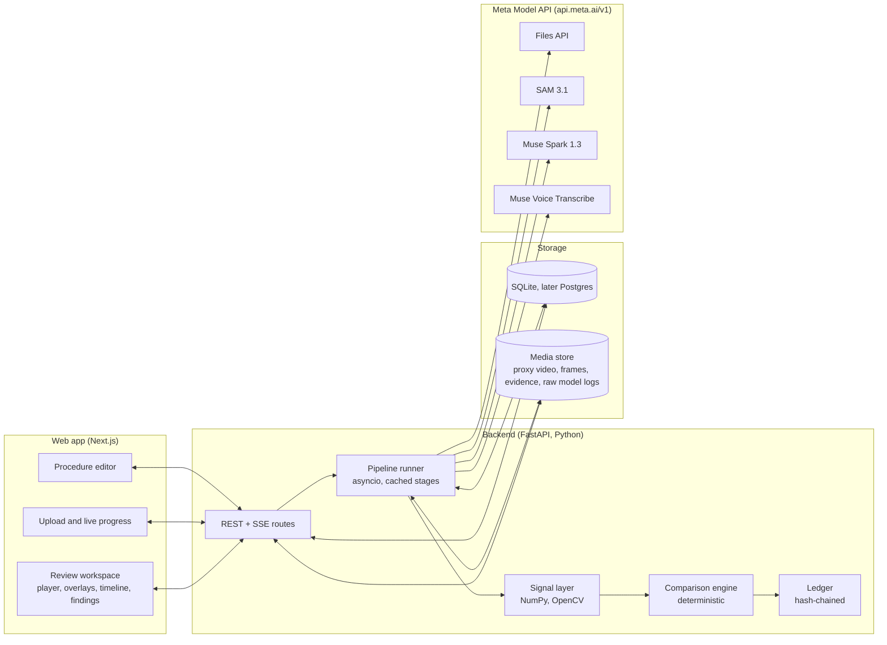
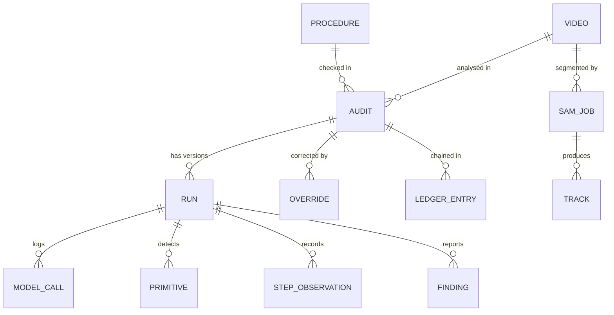
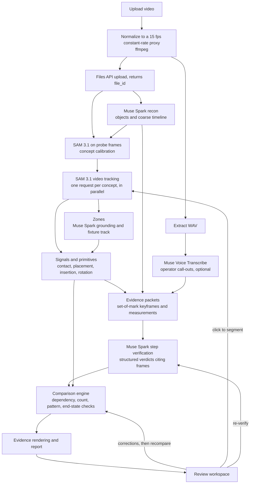

# MotionLedger: implementation plan

**AI that audits how work actually happens.**
Meta Global AI Developer Hackathon · Track: Push the Frontier · Manufacturing

MotionLedger compares a video of a real assembly process with the procedure it was supposed to follow. It reports possible omissions, order changes, and other discrepancies, and links each one to timestamps, frames with segmentation overlays, and the measurements behind it. A reviewer can correct any interpretation and rerun the comparison.

This document is the end-to-end build plan: architecture, every Meta Model API call, the comparison engine, the review loop, prompts and schemas, cost, evaluation, and a milestone schedule. API details were checked against the Meta Model API documentation on 26 October 2026; links are in [References](#22-references).

## Contents

1. [Summary and MVP scope](#1-summary-and-mvp-scope)
2. [Hackathon fit](#2-hackathon-fit)
3. [Meta models and what each one does here](#3-meta-models-and-what-each-one-does-here)
4. [API facts this plan depends on](#4-api-facts-this-plan-depends-on)
5. [System architecture](#5-system-architecture)
6. [Domain model](#6-domain-model)
7. [Analysis pipeline, stage by stage](#7-analysis-pipeline-stage-by-stage)
8. [Reviewer loop: corrections, reruns, ledger](#8-reviewer-loop-corrections-reruns-ledger)
9. [Backend API and pipeline runner](#9-backend-api-and-pipeline-runner)
10. [Frontend](#10-frontend)
11. [Prompts and output schemas](#11-prompts-and-output-schemas)
12. [Cost, latency, and rate limits](#12-cost-latency-and-rate-limits)
13. [Reliability checklist](#13-reliability-checklist)
14. [Privacy, safety, and responsible use](#14-privacy-safety-and-responsible-use)
15. [Evaluation plan](#15-evaluation-plan)
16. [Repository layout](#16-repository-layout)
17. [Local setup](#17-local-setup)
18. [Build schedule](#18-build-schedule)
19. [Demo script](#19-demo-script)
20. [Risks and mitigations](#20-risks-and-mitigations)
21. [Stretch goals and roadmap](#21-stretch-goals-and-roadmap)
22. [References](#22-references)

---

## 1. Summary and MVP scope

MotionLedger takes two inputs, an expected procedure and a video of someone performing it, and produces a step-by-step discrepancy report. Every step gets a status (observed, missing, incomplete, out of order, or unverifiable), and every finding carries a time range, key frames with object overlays, the measurements that triggered it, and a short model rationale.

The design rule is that **models perceive and interpret, and deterministic code decides**:

1. SAM 3.1 turns pixels into tracked objects: hands, parts, tools, and the fixture.
2. A signal layer (our code) turns those tracks into measurable physical events such as contact, placement, insertion, tool rotation, and idle time.
3. Muse Spark checks those events against the procedure by looking at marked keyframes, and returns structured verdicts that cite frame numbers.
4. The comparison engine (our code, unit-tested) reconciles the verdicts with the procedure's dependency graph and emits findings. A finding cannot exist without evidence attached.
5. A reviewer confirms, dismisses, or corrects findings. Every rerun is a new version recorded in a hash-chained ledger.

**MVP scope (what the demo must show)**

- One procedure: flange gasket assembly. Place the gasket, insert four bolts, tighten them in a cross pattern, then an optional inspection. This is the brief's gasket, bolt, and tighten example, extended to four bolts so that count, order, and pattern checks all have something to catch.
- Upload a 30–120 second top-down video and get a report covering omissions, order violations, pattern violations, incomplete steps (too few or too short), repeated and extra actions, failed end-state checks, and unverifiable steps.
- A review workspace with frame-accurate playback, mask overlays, a step timeline, finding cards with evidence, corrections, click-to-segment, instant rerun, version diff, and export.

Out of scope for the MVP: live line-camera streams, multi-camera fusion, MES or QMS integration, and on-prem models (see [roadmap](#21-stretch-goals-and-roadmap)).

## 2. Hackathon fit

- **Problem statement.** Push the Frontier: MotionLedger gives a machine a new capability in manufacturing, checking a physical workflow against its specification with evidence a person can audit.
- **Meta models.** SAM 3.1 and Muse Spark do the core work through Meta Model API. Muse Voice Transcribe adds an optional audio channel, and Muse Code is used to build the project.
- **Anti-project check.** It is not a video summarizer or a simple image analyzer, because the output reconciles expected and observed events into typed discrepancies. It is not RAG, medical, educational, HR screening, sports, or political.
- **Worker-monitoring concern.** The product checks the process, not the person. It has no per-worker scores, it can redact faces, and every machine finding stays a "possible discrepancy" until a reviewer confirms it ([section 14](#14-privacy-safety-and-responsible-use)).

What is technically new:

- **From pixels to physics to rules.** Segmentation masks become physical measurements (contact, rotation, zone occupancy), a multimodal model interprets them alongside images, and symbolic checks over a dependency graph produce the findings.
- **Set-of-mark prompting from SAM masks.** Keyframes sent to Muse Spark carry SAM outlines and short labels (`W` for the wrench, `B@hole_3` for the bolt in hole 3), so the model's rationale refers to specific objects and frames that our code can validate.
- **Occlusion-aware omissions.** The system separates "not done" from "not seen" and reports the second as UNVERIFIABLE instead of accusing anyone.
- **Interactive correction.** A reviewer's click becomes a SAM point prompt that re-tracks the object, and only the affected parts of the analysis are recomputed.

## 3. Meta models and what each one does here

| Model (ID) | What MotionLedger uses it for | Endpoint |
|---|---|---|
| SAM 3.1 (`sam-3.1`) | Track hands, parts, tools, and the fixture through the video; probe concept phrases on single frames; re-track an object from a reviewer's click; optional face redaction | `POST /v1/responses`, `POST /v1/files` |
| Muse Spark 1.3 (`muse-spark-1.3`) | Compile a work instruction into a checkable procedure; watch the whole video for a first pass; suggest better concept phrases; locate zones such as bolt holes on a reference frame; verify each step from marked keyframes and measurements; optional consistency check | `POST /v1/responses` |
| Muse Voice Transcribe (`muse-voice-transcribe-1.0`) | Optional: transcribe operator call-outs ("gasket on", "torque done") with turn timestamps | `POST /v1/asr/transcribe` |
| Muse Code (`muse` CLI) | Building the project: scaffolding, tests, refactors | — |
| Muse Wonder 1.0 (`muse-wonder-1.0`) | Optional drop-in for the consistency check on hard clips; same request shape, higher cost | `POST /v1/responses` |

Use Standard mode (`muse-spark-1.3`) for real footage, because Standard-mode content is not used to train Meta models. Contributor mode (`muse-spark-1.3-contributor`, roughly 10–20 times cheaper per token, limited to 150 requests per minute) is acceptable for synthetic demo clips only.

Muse Image is left out of the analysis on purpose. An audit trail must not contain generated images, so every evidence frame in MotionLedger is cut from the source video.

## 4. API facts this plan depends on

All hosted models share one base URL (`https://api.meta.ai/v1`), one bearer key (`MODEL_API_KEY`), and the OpenAI SDK: set `base_url`, keep the rest.

**SAM 3.1** ([overview](https://dev.meta.ai/docs/sam/overview), [prompts](https://dev.meta.ai/docs/sam/segmenting), [output](https://dev.meta.ai/docs/sam/reading-segmentation), [client libraries](https://dev.meta.ai/docs/sam/client-libraries))

- A request is one Responses API user message with an `input_text` part (the prompt) and one media part: `input_video` with a `file_id` or `video_url`, or `input_image`. Streaming (`stream: true`) is recommended for video.
- The prompt is either a concept or box/point tokens, never both. A concept is a short noun phrase, one per request, without lists, negation, or position words. Box and point prompts use object IDs you choose.
- Metadata values are strings: `mask_encoding: "one_bit"` for compact masks, `include_confidence: "true"` for per-record confidence, and `propagation_direction: "both" | "forward" | "backward"` for box/point prompts in video.
- Limits: MP4 or MOV with H.264, H.265, or MPEG-4 video (VP9 and WebM are rejected); up to 15,000 frames (about 10 minutes) per request; up to 16 tracked objects per frame; up to 16 prompted objects.
- Output is one line per frame in the output-text lane: a `<Nf>` frame marker, then `id<|box…|><|mask…|>` records. Frame indices are zero-based, can skip frames, and are not always ascending. Object IDs are stable within a response while an object stays in view, but not across exit and re-entry or full occlusion. Zero matches is a normal, empty result.
- Each mask is an `H,W` raster covering its record's box, with a base85 payload. Decode it with `meta_sam_parser` (Python) or `@meta-sam/parser` (TypeScript).
- Price: $0.20 per 1,000 video frames with a 50-frame minimum per request, and $2.50 per 1,000 images. Final usage reports `video_frames_processed`.

**Muse Spark 1.3** ([models](https://dev.meta.ai/docs/models), [video](https://dev.meta.ai/docs/video-understanding), [images](https://dev.meta.ai/docs/image-understanding), [structured output](https://dev.meta.ai/docs/structured-output), [reasoning](https://dev.meta.ai/docs/reasoning), [Responses API](https://dev.meta.ai/docs/protocols/responses))

- 1,048,576-token context. Video is MP4, best sent through the Files API as `input_video` or `input_file` with a `file_id`. Up to 50 images per request.
- Structured output on the Responses API uses `text.format` with `type: "json_schema"`, and decoding is always constrained to the schema. Recursive schemas are rejected and nesting is limited to 10 levels.
- `reasoning.effort` ranges from `minimal` to `max`. Reasoning tokens count against `max_output_tokens`. `reasoning.summary: "auto"` returns a short readable summary.
- Perception grounding returns points or boxes on a 0–1000 grid relative to the image sent.
- Long non-streaming calls can time out with HTTP 504, so use `stream: true`, or `background: true` and poll `GET /v1/responses/{id}`. Background request bodies are capped at 1 MiB, so reference media by `file_id`.
- There are no logprobs, so confidence is self-reported and needs calibration.
- Audio understanding on 1.3 is degraded; send speech to Muse Voice Transcribe instead.

**Files API** ([file handling](https://dev.meta.ai/docs/file-handling)): uploads up to 1 GiB, inline media up to 50 MB. Files never expire unless `expires_after` is set (1 hour to 30 days). Storage is capped at 100 GiB per team.

**Muse Voice Transcribe** ([speech to text](https://dev.meta.ai/docs/speech-to-text)): `POST /v1/asr/transcribe` takes a multipart `request` part (JSON settings) and an `audio` part (mono 16-bit PCM WAV at 16 or 24 kHz). Modes are `PUSH_TO_TALK`, `ENDPOINTING`, and `DIARIZATION`; `keywords` biases recognition toward domain terms. The response has `turns[]` with `startMs`, `endMs`, and `transcript`. Price: $0.18 per audio hour.

**Rate limits** ([pricing and rate limits](https://dev.meta.ai/docs/pricing-rate-limits)) apply per team. Paid limits are 3,000 requests per minute per model, plus 4M tokens per minute for Muse Spark; an older docs page lists a free tier at 60 requests per minute. Retry HTTP 429 with exponential backoff and jitter, honoring `Retry-After`. An HTTP 400 is permanent and should not be retried.

## 5. System architecture



**Components**

- **Web app** (Next.js, TypeScript): the procedure editor, upload with live progress, and the review workspace. It talks only to our backend; the Meta API key never reaches the browser.
- **Backend** (FastAPI): REST plus Server-Sent Events for progress. The pipeline runner executes each analysis as a graph of stages, and stores every stage's output under a hash of its inputs, so reruns only recompute what changed.
- **Signal layer**: NumPy and OpenCV geometry over decoded masks.
- **Comparison engine**: pure Python with no I/O and no model calls. The same inputs always produce the same findings.
- **Ledger**: an append-only, hash-chained record of runs, model calls, corrections, and exports.
- **Storage**: SQLite and a local media directory for the hackathon; Postgres and S3-compatible storage later.

**Key decisions**

1. **One proxy video is the clock.** Ingest converts every upload to a constant-frame-rate MP4, 15 fps by default. SAM, Muse Spark, the evidence renderer, and the browser player all use that file, so frame `n` means time `n / 15` seconds everywhere.
2. **Models never write findings.** They produce observations with confidence; the engine decides what is a finding.
3. **Raw model outputs are kept verbatim** (SAM event logs and Muse Spark responses), keyed by content hash. That makes reruns reproducible, powers an offline demo mode, and lets the browser decode masks itself.
4. **Python backend**, because the hot path is mask geometry and ffmpeg, and Meta ships an official Python SAM parser (`meta_sam_parser`).
5. **No queue infrastructure for the MVP.** An in-process asyncio runner with a database-backed job table and per-model semaphores is enough for a single-node demo. arq or Celery can replace it later without changing stage code.

## 6. Domain model

Terms used in the rest of this plan:

- **Procedure**: the expected work, as a versioned JSON document (often called an SOP).
- **Step instance**: one occurrence a step requires. "Insert 4 bolts" expands into `S2@hole_1` through `S2@hole_4`.
- **Zone**: a region where something should end up or rest, such as a bolt hole or the tool tray.
- **Primitive**: a low-level physical event measured from tracks, such as "wrench rotated 212° at hole 3 for 2.6 s".
- **Evidence packet**: the keyframes, measurements, and procedure text sent to Muse Spark to verify one step.
- **Finding**: a typed discrepancy with evidence, produced by the comparison engine.
- **Audit**: one video checked against one procedure version. **Run**: one version of an audit's analysis.

### 6.1 Procedure specification

```json
{
  "id": "flange-assembly",
  "version": 3,
  "title": "Pipe flange gasket assembly",
  "camera": "Fixed, top-down, whole fixture and tool tray in frame",
  "objects": [
    { "key": "hand",   "concept": "hand",                 "role": "actor",   "expected_count": 2 },
    { "key": "gasket", "concept": "orange rubber gasket", "role": "part",    "expected_count": 1 },
    { "key": "bolt",   "concept": "hex bolt",             "role": "part",    "expected_count": 4 },
    { "key": "wrench", "concept": "wrench",               "role": "tool",    "expected_count": 1 },
    { "key": "flange", "concept": "metal flange plate",   "role": "fixture", "expected_count": 1 }
  ],
  "zones": [
    { "key": "gasket_seat", "label": "Gasket seat",          "anchor": "flange", "source": "grounding" },
    { "key": "hole_1",      "label": "Bolt hole 1 (top)",    "anchor": "flange", "source": "grounding" },
    { "key": "hole_2",      "label": "Bolt hole 2 (right)",  "anchor": "flange", "source": "grounding" },
    { "key": "hole_3",      "label": "Bolt hole 3 (bottom)", "anchor": "flange", "source": "grounding" },
    { "key": "hole_4",      "label": "Bolt hole 4 (left)",   "anchor": "flange", "source": "grounding" },
    { "key": "tool_tray",   "label": "Tool tray",            "anchor": "",       "source": "manual" }
  ],
  "steps": [
    {
      "id": "S1", "title": "Place gasket on flange face",
      "action": "place", "subject": "gasket", "tool": "", "target_zone": "gasket_seat",
      "repeat": null, "requires": [], "min_duration_s": 0, "optional": false,
      "criticality": "critical",
      "evidence_hints": {
        "performed": "The gasket is carried onto the flange and stays centred on it.",
        "skipped": "The flange face is bare when the first bolt goes in."
      }
    },
    {
      "id": "S2", "title": "Insert bolts",
      "action": "insert", "subject": "bolt", "tool": "", "target_zone": "hole_*",
      "repeat": { "count": 4, "per": "zone", "pattern": [] },
      "requires": [{ "step": "S1", "scope": "all" }],
      "min_duration_s": 0, "optional": false, "criticality": "major",
      "evidence_hints": {
        "performed": "A bolt is carried to each hole and stays upright in it.",
        "skipped": "A hole is still empty at the end."
      }
    },
    {
      "id": "S3", "title": "Tighten bolts in cross pattern",
      "action": "tighten", "subject": "bolt", "tool": "wrench", "target_zone": "hole_*",
      "repeat": { "count": 4, "per": "zone", "pattern": ["hole_1", "hole_3", "hole_2", "hole_4"] },
      "requires": [{ "step": "S2", "scope": "same_instance" }],
      "min_duration_s": 1.5, "optional": false, "criticality": "critical",
      "evidence_hints": {
        "performed": "The wrench engages the bolt head and turns through several strokes.",
        "skipped": "The wrench stays in the tray, or touches the bolt without turning."
      }
    },
    {
      "id": "S4", "title": "Visual inspection",
      "action": "inspect", "subject": "flange", "tool": "", "target_zone": "",
      "repeat": null, "requires": [{ "step": "S3", "scope": "all" }],
      "min_duration_s": 0, "optional": true, "criticality": "minor",
      "evidence_hints": { "performed": "The operator pauses over the finished flange.", "skipped": "" }
    }
  ],
  "postconditions": [
    { "id": "P1", "description": "Four bolts seated at the end", "check": "count_in_zones", "object": "bolt", "zones": "hole_*", "equals": 4 },
    { "id": "P2", "description": "Gasket on the flange at the end", "check": "present_in_zone", "object": "gasket", "zones": "gasket_seat", "equals": 1 }
  ],
  "vocabulary": ["gasket", "flange", "bolt", "wrench", "torque", "cross pattern"],
  "open_questions": []
}
```

How the fields are used:

- `concept` is the exact phrase sent to SAM, so it follows SAM's prompt rules: one to four concrete words, with colour or material allowed. The editor lints it and offers a "Test on frame" button.
- `requires` expresses order as a dependency graph rather than a list, so "any order" sections are representable. `scope: "same_instance"` means per zone (tighten bolt k only after inserting bolt k); `scope: "all"` means after every instance of the prerequisite.
- `repeat.per: "zone"` expands a step into one instance per matching zone (`hole_*` is a prefix pattern). `pattern` constrains the order of those instances.
- `postconditions` are checked on the final two seconds of video, independently of how the steps were detected.
- The server assigns `id` and `version`; every edit creates a new version, and audits pin the version they ran against.

### 6.2 Action types and how each one is observed

| Action | Measured by the signal layer | Shown to Muse Spark |
|---|---|---|
| place | Hand contact, object carried, object settles in the target zone, hand releases | Before, carry, and settled frames |
| insert | Object reaches the zone, then its mask area shrinks or it stays upright in the zone after release | Approach and seated frames, zoom crop |
| tighten, loosen | Tool contacts the subject in the zone; total rotation of the tool's principal axis, stroke count, duration | Stroke frames, optional short motion clip |
| connect, press | Two masks touch and stay together; hand dwell | Before, during, after |
| apply | Applicator dwells over the zone | Dwell frames |
| inspect | Hands still, no object motion, dwell over the fixture | Dwell frames (low weight, often optional) |
| remove | Object leaves the zone and does not return | Before and after |

### 6.3 Discrepancy types

| Type | Meaning | Example | Default severity |
|---|---|---|---|
| OMISSION | A required step has no supporting evidence, and the camera had a clear view of where it should have happened | The wrench never leaves the tray | From the step's criticality |
| ORDER_VIOLATION | A step started before a step it depends on finished | Bolts inserted before the gasket | Higher of the two steps |
| PATTERN_VIOLATION | Instances of a repeated step happened in the wrong sequence | Tightened 1-2-3-4 instead of 1-3-2-4 | From the step's criticality |
| INCOMPLETE | Fewer instances than required, or shorter than the minimum duration | 3 of 4 bolts tightened; a 0.3 s touch | From the step's criticality |
| REPEATED | More instances than allowed | Gasket placed, lifted, and placed again | Info |
| EXTRA_ACTION | Significant activity that matches no step | A hammer used on the flange | Info |
| POSTCONDITION_FAILED | The end state contradicts the procedure | Only 3 bolts in holes at the end | High |
| UNVERIFIABLE | The decisive moment is hidden by occlusion, the frame edge, or blur | The operator's arm covers bolt 4 while tightening | "Needs check", not a defect |

Criticality maps to severity as critical = high, major = medium, minor = low. UNVERIFIABLE items are reported in their own "needs check" lane, so the system never turns "couldn't see" into "didn't happen".

### 6.4 Entities



- **Video**: original path, proxy path, SHA-256, fps, displayed width and height, frame count, Files API `file_id`, and expiry.
- **SamJob**: the prompt (concept text or box/point prompt), metadata, raw event log path, frames billed, and status. It is cached per (video hash, prompt, metadata), so reruns reuse it.
- **Track**: object key, SAM object ID, stitched ID, and per-frame arrays (box, confidence, area, centroid, orientation, COCO RLE mask) stored as a compressed `.npz` next to the event log.
- **Run**: parent run, config snapshot, model IDs, stage timings, and total cost.
- **Primitive**: type, objects, zone, start and end frame, measured features, and signal confidence.
- **StepObservation**: step instance, start and end frame, status, fused confidence, cited frames, rationale, and source (`rules`, `muse`, or `reviewer`).
- **Finding**: type, step instances, severity, confidence, time range, key moment, evidence bundle path, and status (`open`, `confirmed`, or `dismissed`).
- **Override**: a reviewer correction ([section 8](#8-reviewer-loop-corrections-reruns-ledger)).
- **ModelCall**: model, endpoint, request hash, response ID, token or frame usage, latency, and cost.
- **LedgerEntry**: sequence number, kind, payload hash, previous hash, and hash.

## 7. Analysis pipeline, stage by stage



After the upload, recon and concept probes run in parallel; concept tracks run four at a time; verification calls run six at a time. Every stage is cached by a hash of its inputs.

### 7.1 Procedure authoring (Muse Spark)

Muse Spark turns a work instruction, pasted as text or uploaded as a PDF, into the procedure schema; a person then fixes it in the editor.

- A PDF is uploaded with `purpose="user_data"` and passed as `input_file`; the API converts it to text plus page images.
- The call uses `text.format` with the `ProcedureSpec` schema ([section 11](#11-prompts-and-output-schemas)) and `reasoning.effort: "high"`.
- Code then validates the result: the dependency graph must be acyclic (topological sort), every referenced key must exist, `repeat.count` must agree with `expected_count`, and every concept must pass the lint (one to four words; no commas, "and", "or", "not", verbs, or position words such as "left").
- `open_questions` from the model are shown in the editor for the author to resolve.

```python
SPARK = "muse-spark-1.3"

async def compile_procedure(client, text: str | None, pdf_file_id: str | None) -> ProcedureSpec:
    content = [{"type": "input_text", "text": text or "Compile the attached work instruction."}]
    if pdf_file_id:
        content.append({"type": "input_file", "file_id": pdf_file_id})
    resp = await client.responses.create(
        model=SPARK,
        reasoning={"effort": "high"},
        instructions=SOP_COMPILER_INSTRUCTIONS,
        input=[{"type": "message", "role": "user", "content": content}],
        text={"format": {"type": "json_schema", "name": "ProcedureSpec",
                         "schema": ProcedureSpec.model_json_schema()}},
        max_output_tokens=16000,
    )
    return ProcedureSpec.model_validate_json(resp.output_text)
```

### 7.2 Ingest and normalization (ffmpeg)

This stage produces the single proxy file that every later stage uses.

1. Run `ffprobe` on the upload. Reject anything that isn't decodable video, is longer than 5 minutes (an MVP cap; SAM allows about 10), or is larger than 1 GiB.
2. Compute the target size in Python: longest edge at most 1280 px, even dimensions, never upscaled. Swap width and height when ffprobe reports a ±90° rotation.
3. Transcode to constant 15 fps H.264 MP4 with the index at the front of the file. ffmpeg applies phone rotation flags while decoding, so the proxy's width and height are the displayed size, which is what SAM prompt coordinates must use.
4. Extract a mono 24 kHz WAV for Muse Voice Transcribe, or skip the voice stage if there is no audio stream.
5. Record the SHA-256, fps, size, and exact frame count.

```python
def target_size(width: int, height: int, max_edge: int = 1280) -> tuple[int, int]:
    scale = min(1.0, max_edge / max(width, height))
    return int(width * scale) // 2 * 2, int(height * scale) // 2 * 2
```

```bash
ffmpeg -y -i upload.mov \
  -vf "fps=15,scale=1280:720:flags=lanczos" -fps_mode cfr \
  -c:v libx264 -preset veryfast -crf 20 -pix_fmt yuv420p -g 15 \
  -c:a aac -ac 1 -b:a 96k \
  -movflags +faststart proxy.mp4

ffmpeg -y -i proxy.mp4 -vn -ac 1 -ar 24000 -c:a pcm_s16le -map_metadata -1 audio.wav

ffprobe -v error -select_streams v:0 -count_frames \
  -show_entries stream=width,height,r_frame_rate,nb_read_frames -of json proxy.mp4
```

Here `scale=1280:720` is the size computed for a 16:9 landscape source, and `-g 15` puts a keyframe every second so browser seeking stays responsive. `-fps_mode` needs ffmpeg 5.1 or newer; older builds use `-vsync cfr`.

Why 15 fps: tool strokes and placements last several hundred milliseconds, so 15 fps resolves them, and SAM is billed per frame, so it costs half of what 30 fps would. `ANALYSIS_FPS` is configurable.

Frames for probes and evidence are extracted by decoding the proxy sequentially with OpenCV rather than seeking, so frame `n` is exactly the n-th decoded frame. That is the indexing SAM's frame markers and the browser player use.

### 7.3 Upload to the Files API

```python
async def upload_proxy(client, proxy: Path, ttl_s: int = 7 * 24 * 3600) -> str:
    uploaded = await client.files.create(
        file=(proxy.name, proxy.read_bytes(), "video/mp4"),
        purpose="user_data",
        expires_after={"anchor": "created_at", "seconds": ttl_s},
    )
    return uploaded.id
```

The upload is synchronous, so the returned `file-…` ID is usable immediately. One upload serves every SAM and Muse Spark call for the video, so video bytes are never sent twice. The file is deleted with `client.files.delete(file_id)` when the audit is archived.

### 7.4 Scene reconnaissance (Muse Spark on the full video)

A first look at the whole clip that:

- confirms which procedure objects are visible,
- proposes alternative concept phrases where an object looks different from its phrase,
- produces a coarse activity timeline, used as a prior for where to look,
- lists objects that aren't in the procedure and camera problems such as blur or glare.

Recon output is never evidence on its own. Its timestamps are approximate and are only used to seed or widen candidate windows by ±2 seconds.

```python
async def recon(client, video, sop) -> ReconReport:
    job = await client.responses.create(
        model=SPARK,
        background=True,
        reasoning={"effort": "medium"},
        instructions=RECON_INSTRUCTIONS,
        input=[{"type": "message", "role": "user", "content": [
            {"type": "input_text", "text":
                f"Procedure:\n{sop.model_dump_json()}\n\n"
                f"The video is {video.duration_s:.1f} s long at {video.fps} fps."},
            {"type": "input_video", "file_id": video.file_id},
        ]}],
        text={"format": {"type": "json_schema", "name": "ReconReport",
                         "schema": ReconReport.model_json_schema()}},
        max_output_tokens=16000,
    )
    while job.status in ("queued", "in_progress"):
        await asyncio.sleep(2)
        job = await client.responses.retrieve(job.id)
    if job.status != "completed":
        raise StageError(f"recon ended with status {job.status}")
    return ReconReport.model_validate_json(job.output_text)
```

Background mode survives client disconnects and avoids the 504 that a long non-streaming call can hit.

### 7.5 Concept calibration (SAM on single frames, Muse Spark for rephrasing)

Before paying for full-video tracking, MotionLedger checks that each concept phrase actually finds its object.

1. Pick three probe frames (start, middle, end), shifted toward recon activities that mention the object.
2. For each object, run SAM image segmentation with its concept on each probe frame, sending the frame as a JPEG data URL in an `input_image` part ($0.0025 per image).
3. If an object gets zero matches on every probe, try recon's suggested phrases, then ask Muse Spark for a phrase while showing it the probe frame. If that still finds nothing, flag it in the UI ("Bolt not found: click it to segment"), which uses the path in [section 8.3](#83-click-to-segment).
4. If a phrase matches too much (more than 1.5 × `expected_count` on the clearest frame, for example "bolt" also matching nuts), ask Muse Spark for a more specific phrase such as "hex bolt head" and probe again.
5. Store the winning phrase per object for this audit.

This takes about 30 images, under $0.10 per audit.

### 7.6 Object tracking (SAM 3.1 on the full video)

Each concept gets one streaming request; four run at a time. Requests ask for one-bit masks and confidence, and the event stream is written to a JSONL log as it arrives.

One integration detail matters here. The API emits `response.content_part.done` but not `response.output_text.done`, and the parser waits for the latter to close the text lane. Meta's cookbook synthesizes the missing event; `close_text_lanes` below is the same adapter. The log stores the adapter's output, so it replays cleanly through both the Python and TypeScript parsers.

```python
import json
from contextlib import aclosing
from meta_sam_parser import parse_responses_stream, video_segmentation_format

SAM = "sam-3.1"

async def close_text_lanes(stream):
    """The API sends only response.content_part.done; the parser needs response.output_text.done."""
    closed = set()
    async for event in stream:
        data = event.model_dump() if hasattr(event, "model_dump") else dict(event)
        lane = (data.get("item_id"), data.get("output_index"), data.get("content_index"))
        if data.get("type") == "response.output_text.done":
            if lane not in closed:
                closed.add(lane)
                yield data
            continue
        yield data
        part = data.get("part")
        if (data.get("type") == "response.content_part.done" and lane not in closed
                and isinstance(part, dict) and part.get("type") == "output_text"):
            closed.add(lane)
            yield {"type": "response.output_text.done", "item_id": lane[0],
                   "output_index": lane[1], "content_index": lane[2], "text": part.get("text", "")}

async def tee_jsonl(events, path: Path):
    with path.open("w", encoding="utf-8") as fh:
        async for data in events:
            fh.write(json.dumps(data, separators=(",", ":")) + "\n")
            yield data

async def track_concept(client, file_id: str, concept: str, log: Path, on_progress):
    stream = await client.responses.create(
        model=SAM,
        stream=True,
        input=[{"type": "message", "role": "user", "content": [
            {"type": "input_text", "text": concept},
            {"type": "input_video", "file_id": file_id},
        ]}],
        metadata={"mask_encoding": "one_bit", "include_confidence": "true"},
    )
    async with (
        stream,
        aclosing(close_text_lanes(stream)) as lanes,
        aclosing(tee_jsonl(lanes, log)) as events,
    ):
        parsed = parse_responses_stream(events, video_segmentation_format())
        async with parsed:
            async for snapshot in parsed:
                on_progress(len(snapshot.records))
            result = await parsed.final_result()
    if result.outcome.status != "completed":
        raise StageError(f"SAM '{concept}' ended early: {result.outcome}")
    return result
```

**From records to frame geometry.** Each record pairs one box and one mask for an object on a frame. The mask raster covers the box; when its size differs from the box, it is scaled to the box, which is the same mapping Meta's sticker-pack recipe uses.

```python
import cv2
import numpy as np
from meta_sam_parser import decode_mask_to_raster

def iter_object_masks(result):
    boxes = {(r.frame.frame_index, r.object_id): r for r in result.records if r.kind == "box"}
    for r in result.records:
        if r.kind != "mask":
            continue
        box = boxes[(r.frame.frame_index, r.object_id)]
        raster = np.fromiter(decode_mask_to_raster(r.mask), dtype=np.uint8,
                             count=r.mask.width * r.mask.height).reshape(r.mask.height, r.mask.width)
        box_w, box_h = box.right - box.left, box.bottom - box.top  # parser boxes are half-open
        if raster.shape != (box_h, box_w):
            raster = cv2.resize(raster, (box_w, box_h), interpolation=cv2.INTER_NEAREST)
        yield r.frame.frame_index, r.object_id, box, raster, box.confidence
```

Per-frame features stored for each track: box, confidence, area, centroid, the principal-axis angle from image moments (θ = ½·atan2(2μ11, μ20 − μ02)), and the mask as COCO RLE (`decode_mask_to_rle`) for compact storage.

**Track stitching.** SAM object IDs hold while an object stays in view, but not across full occlusion or leaving and re-entering the frame. Within one concept, a tracklet that ends is linked to one that starts within 1 second if the new tracklet's first box is within half an object diagonal of the old one's last box; when several candidates compete, Hungarian assignment on centroid distance plus (1 − IoU) picks the pairing. For identical parts, identity after insertion comes from the zone (the bolt in `hole_3` is `bolt@hole_3`), so stitching mistakes stop mattering once parts are seated.

### 7.7 Zones (Muse Spark grounding and the fixture track)

Zones come from three sources in priority order: drawn by the reviewer (always wins), located by Muse Spark on a reference frame, or segmented by SAM (for example the concept "bolt hole", which is worth trying first).

1. The reference frame is the first frame where the flange track is fully visible and no hand overlaps it.
2. Muse Spark points at every "bolt hole" (count mode) in one call and boxes the "gasket seat area" and "tool tray" in another, because grounding is most reliable with one output shape per prompt. Normalized values convert to pixels as `x = round(x_n × W / 1000)`, clamped to the frame.
3. Holes are numbered deterministically: sort the points clockwise by angle around the flange centroid, starting from the top-most. The model's own numbering is never used.
4. Each hole becomes a circle with a radius of about 0.6 × the median bolt-head width. Zones are stored in coordinates normalized to the flange box on the reference frame.
5. On every frame, anchored zones are re-projected through the flange box (translation and scale), so a nudged fixture or a slightly moved camera doesn't break zone checks.

### 7.8 Signals and action primitives (deterministic)

Per-frame relations, computed inside the union box of the two objects for speed:

- **contact(hand, object)**: overlap between the hand mask dilated by 8 px and the object mask, as a fraction of the object's area.
- **in_zone(object, zone)**: fraction of the object mask inside the zone.
- **speed(object)**: centroid displacement per frame, smoothed over 5 frames.
- **occlusion(zone)**: fraction of the zone covered by hand masks (and an optional "person" concept). This is what separates "didn't happen" from "couldn't see".

Primitive detectors use hysteresis (separate start and stop thresholds) and minimum durations. All thresholds live in `config/signals.yaml` and are tuned on the evaluation clips.

| Primitive | Fires when |
|---|---|
| contact(hand, obj) | Contact is at least 2% of the object's area for 0.3 s; ends after 0.3 s below 1% |
| carried(obj) | During contact, the centroid moves more than 0.25 × the object diagonal |
| placed(obj, zone) | After being carried, speed stays under 2 px per frame for 0.5 s with in_zone ≥ 0.6, and hand contact has ended |
| inserted(bolt, hole) | The bolt centroid is in the hole zone and either its mask area drops by 30% (the shaft disappears) or it stays static in the zone after release |
| rotated(tool, zone) | The tool touches the subject inside the zone and its cumulative angle reaches 90°, or it reverses direction 3 times (ratchet strokes); duration is recorded |
| idle(tool, zone) | The tool stays in its rest zone for the whole window; this is negative evidence for tool-based steps |
| dwell(obj, zone) | in_zone ≥ 0.6 and near-zero speed for at least the step's minimum duration |

Rotation is computed by interpolating angle gaps of up to 5 frames, unwrapping with `np.unwrap(2θ) / 2` (a principal axis is only defined modulo 180°), median-filtering, ignoring per-frame changes under 1°, and then summing absolute changes and counting sign reversals. A top-down camera turns wrench strokes into in-plane rotation, which is why the rig in [section 15](#15-evaluation-plan) uses one.

Each primitive is stored with its measured features and a signal confidence, a logistic function of how far the main feature clears its threshold:

```json
{ "type": "rotated", "objects": ["wrench"], "zone": "hole_1", "start_frame": 452, "end_frame": 489,
  "features": { "total_deg": 212, "reversals": 5, "duration_s": 2.5, "contact_ratio": 0.31 },
  "confidence": 0.87 }
```

These heuristics will sometimes miss or misfire, and that is acceptable. Their job is to propose candidate windows and produce numbers that Muse Spark checks against images and that a reviewer can read.

### 7.9 Operator call-outs (Muse Voice Transcribe, optional)

```python
async def transcribe_callouts(http: httpx.AsyncClient, wav: Path, vocabulary: list[str]) -> list[dict]:
    settings = {"mode": "ENDPOINTING", "model": "muse-voice-transcribe-1.0",
                "audioEncoding": "WAV", "keywords": vocabulary}
    r = await http.post(
        "https://api.meta.ai/v1/asr/transcribe",
        headers={"Authorization": f"Bearer {os.environ['MODEL_API_KEY']}"},
        files={"request": (None, json.dumps(settings), "application/json"),
               "audio": (wav.name, wav.read_bytes(), "audio/wav")},
        timeout=120,
    )
    r.raise_for_status()
    return [{"start_s": t["startMs"] / 1000, "end_s": t["endMs"] / 1000, "text": t["transcript"]}
            for t in r.json()["turns"]]
```

Turns go into evidence packets as context, for example "operator said 'done' at 48.1 s". Speech is a claim, not proof: it can move an UNVERIFIABLE instance to "verbally confirmed, needs check", but it never marks a step as observed by itself. The procedure's `vocabulary` biases recognition toward domain terms.

### 7.10 Step verification (Muse Spark on marked keyframes)

This is where Muse Spark reasons over the visual observations and the expected procedure. There is one call per step; repeated steps send all their instances in one call so the model can compare them.

**Candidate windows** for each instance are the union of:

1. windows of primitives that match the step's action, subject, and zone;
2. recon activities that mention the step, padded by ±2 seconds;
3. if neither exists, the **expected window**: from the end of the latest prerequisite to the start of the earliest dependent step, or the end of the video.

The expected window is what makes omissions checkable: the model is shown where the step should have happened.

**Each evidence packet contains**, within a budget of about 12 images per instance and at most 40 per call (the API cap is 50; a frame shared by neighbouring instances is sent once):

- Keyframes at the window start minus 1 s, the start, signal peaks (such as maximum rotation speed), the end, and the end plus 1 s. For an expected window with no activity, evenly spaced frames plus the final frame.
- One clean frame with no overlays, so marks never hide the detail that matters.
- Up to two zoom crops around the relevant objects (their union box plus a 25% margin, resized to 768 px), because bolt heads are small.
- Set-of-mark overlays on the other frames: thin coloured mask outlines with short labels (`H` hand, `W` wrench, `G` gasket, `B@hole_3`), and a header strip above the image reading `F00602 · 40.13 s` so frame numbers never cover content.
- A measurement block, for example:

```text
Step S3 "Tighten bolts in cross pattern": tighten, subject bolt, tool wrench, zones hole_1..hole_4,
at least 1.5 s each, pattern hole_1, hole_3, hole_2, hole_4.
Instances to judge: S3@hole_1, S3@hole_2, S3@hole_3, S3@hole_4.

Measurements (15 fps):
- wrench: in tool_tray F00000-F00431, carried F00432-F00451, back in tool_tray from F00712
- rotated(wrench, hole_1): F00452-F00489, 212 deg, 5 reversals, 2.5 s
- rotated(wrench, hole_2): F00611-F00650, 188 deg, 4 reversals, 2.6 s
- hole_3: no wrench contact in expected window F00309-F00960
- hole_4: hand covers 78% of the zone during F00660-F00705
- call-out: "done" at 48.1-48.5 s
Marks: H = hand, W = wrench, G = gasket, B@hole_k = bolt in hole k.
```

- For tighten, loosen, press, and connect steps, optionally a motion clip of the window of up to 10 seconds, cut with ffmpeg and uploaded with a one-hour expiry. Its offset is stated in the text so the model's times can be mapped back.

```python
async def verify_step(client, sop, step, packet):
    content = [{"type": "input_text", "text": packet.measurements_text()}]
    for kf in packet.keyframes:
        content.append({"type": "input_text", "text": f"F{kf.frame:05d} at {kf.t:.2f} s ({kf.role})"})
        content.append({"type": "input_image", "image_url": kf.jpeg_data_url})
    resp = await client.responses.create(
        model=SPARK,
        reasoning={"effort": "high" if step.criticality == "critical" else "medium", "summary": "auto"},
        instructions=VERIFIER_INSTRUCTIONS.format(sop_json=sop.model_dump_json()),
        input=[{"type": "message", "role": "user", "content": content}],
        text={"format": {"type": "json_schema", "name": "StepVerdict",
                         "schema": StepVerdict.model_json_schema()}},
        max_output_tokens=12000,
        prompt_cache_key=f"{sop.id}:{sop.version}",
        store=True,
    )
    verdict = StepVerdict.model_validate_json(resp.output_text)
    summary = next((s.text for item in resp.output if item.type == "reasoning"
                    for s in item.summary), None)
    return verdict, summary, resp.id
```

The instructions, which contain the procedure JSON, come first and are identical across calls for one procedure version, so `prompt_cache_key` lets them hit the prompt cache at the cached-input price. `store=True` keeps the response so a reviewer-triggered re-verify can continue from it ([section 8.2](#82-rerun-modes)); those reviewer-triggered calls also set `safety_identifier` to a hash of the reviewer's ID.

**After the call, code checks the verdict:**

- Every cited frame must be one we sent, and every mark must be one we drew. An unknown citation sets that instance's model confidence to 0 and flags it.
- `start_frame` and `end_frame` must fall inside the window.
- The verdict is fused with the signal layer. When they agree, confidence = 0.6 × model + 0.4 × signal (weights tuned on the evaluation set). When they disagree strongly (opposite verdicts and a confidence gap above 0.5), the instance becomes `needs_review` and the reviewer sees both sides.
- Self-reported confidence is calibrated with a lookup table fitted on the evaluation set, since Muse Spark has no logprobs.

**Optional consistency pass** (the first thing to cut if time is short): send the full video and the verified timeline to Muse Spark and ask for steps that may have happened outside the checked windows, or verdicts that the footage contradicts. Its output only creates new candidate windows that go back through this stage; it never creates findings directly.

### 7.11 Comparison engine (deterministic)

The engine takes the procedure, step observations (fused machine verdicts plus reviewer overrides), primitives, zone tracks, and end-state measurements, and returns per-instance statuses and findings. It has no I/O and makes no model calls, so it runs in milliseconds, which is what makes reruns instant.

```text
instances = expand(procedure)            # S3 -> S3@hole_1..S3@hole_4, with per-instance prerequisites

for each instance, prerequisites first:
    if a reviewer override exists                       -> status from the override
    elif an observation has confidence >= 0.60          -> observed
        if its duration < step.min_duration_s           -> too_short
    elif needs_review, or confidence in [0.35, 0.60),
         or zone occlusion in the expected window > 30% -> unverifiable
    elif a same_instance prerequisite is missing or blocked
                                                        -> blocked (listed under the prerequisite's finding)
    elif step.optional                                  -> skipped_optional
    else                                                -> missing

for each step (blocked instances don't count as missing):
    every instance missing                              -> OMISSION
    some instances missing                              -> INCOMPLETE (which zones)
    any instance too_short                              -> INCOMPLETE (duration)
    any instance unverifiable                           -> UNVERIFIABLE (needs check)
    more observations than repeat.count                 -> REPEATED
    pattern set, and the observed order differs from the pattern
    restricted to observed instances                    -> PATTERN_VIOLATION

for each prerequisite A -> B (per zone for same_instance, across all for all):
    both observed and start(B) < end(A) - 0.5 s         -> ORDER_VIOLATION

for each postcondition, on the median of the last 2 s   -> POSTCONDITION_FAILED if false
for each primitive with confidence >= 0.7 that no instance claims -> EXTRA_ACTION

merge findings that share instances or zones into one card (e.g. INCOMPLETE S2 at hole_4 and P1)
priority = severity weight x confidence; sort by priority
```

Comparing the pattern only against observed instances keeps the two problems separate: a missing bolt is reported as INCOMPLETE, and the order of the bolts that were tightened is checked independently. Pattern checks can optionally accept cyclic rotations, since a cross pattern may start at any bolt.

The `blocked` status keeps one mistake from cascading. If bolt 4 was never inserted, `S3@hole_4` cannot have been tightened either, so it is listed under the insertion finding instead of producing a second "not tightened" finding.

**Expected-versus-observed view.** For display, the engine also aligns the expected instance sequence (canonical order, with pattern order inside repeated steps) with the observed instances sorted by start time, using Needleman–Wunsch with an extra adjacent-swap move. Findings come from the dependency checks above, which handle partial orders correctly; the alignment only draws the side-by-side chart.

**Report status.** A report is `CLEAN` when there are no open findings and no unverifiable critical steps, and `REVIEW` otherwise. Only a reviewer can mark an audit `NONCONFORMING` or `ACCEPTED`; the machine never declares a failure.

### 7.12 Evidence packaging

For each finding, the renderer (OpenCV and ffmpeg, working only from the proxy) writes:

- key frames with overlays, each with a clean twin,
- a mini-clip from 2 seconds before to 2 seconds after the key moment, with overlays burned in,
- signal series for charts, such as wrench angle over time, contact intervals, and zone occlusion,
- the procedure clause, the model's rationale and reasoning summary, and the verdict's response ID.

For an omission, the evidence is the expected window plus negative evidence: frames across the window, the tool's rest-zone status ("wrench in tool_tray for 100% of frames 347–960"), and the end-state frame.

Optional redaction runs the SAM concept "face" over the proxy and blurs those masks in every exported frame and clip.

Report excerpt for the brief's own example, where the gasket and bolts appear but the tightening step was skipped:

```jsonc
{
  "audit_id": "aud_7Q2",
  "run": { "version": 1, "parent": null, "models": { "perception": "sam-3.1", "reasoning": "muse-spark-1.3" }, "cost_usd": 1.94 },
  "video": { "duration_s": 64.0, "fps": 15, "frames": 960, "width": 1280, "height": 720 },
  "procedure": { "id": "flange-assembly", "version": 3 },
  "status": "REVIEW",
  "instances": [
    { "id": "S1",        "status": "observed", "frames": [63, 118],  "confidence": 0.93 },
    { "id": "S2@hole_1", "status": "observed", "frames": [181, 214], "confidence": 0.90 },
    { "id": "S2@hole_4", "status": "observed", "frames": [322, 347], "confidence": 0.86 },
    { "id": "S3@hole_1", "status": "missing",  "expected_window": [214, 960], "confidence": 0.84 }
    // S2@hole_2..3 and S3@hole_2..4 omitted here
  ],
  "findings": [
    {
      "id": "F1",
      "type": "OMISSION",
      "instances": ["S3@hole_1", "S3@hole_2", "S3@hole_3", "S3@hole_4"],
      "severity": "high",
      "confidence": 0.84,
      "time_range_s": [14.27, 64.0],
      "key_moment_s": 23.13,
      "explanation": "All four bolts were seated by 23.1 s, but the wrench stayed in the tool tray for the rest of the clip and no rotation was measured at any hole.",
      "evidence": {
        "frames": [
          { "frame": 347, "t": 23.13, "role": "after last insert", "image": "evidence/F1/f00347.jpg" },
          { "frame": 600, "t": 40.00, "role": "expected window",   "image": "evidence/F1/f00600.jpg" },
          { "frame": 955, "t": 63.67, "role": "end state",         "image": "evidence/F1/f00955.jpg" }
        ],
        "measurements": [
          "wrench in tool_tray for 100% of frames 347-960",
          "rotation at holes 1-4: 0 deg",
          "zone occlusion in expected window: 4%"
        ],
        "model": {
          "verdict": "not_performed",
          "decisive_frames": [347, 600, 955],
          "rationale": "The wrench (W) never leaves the tray between F00347 and F00955, and B@hole_1 to B@hole_4 show no tool contact.",
          "response_id": "resp_..."
        },
        "clip": "evidence/F1/clip.mp4"
      },
      "status": "open"
    }
  ],
  "ledger_head": "9c1f4e..."
}
```

The full report schema is frozen in milestone M0 ([section 18](#18-build-schedule)) as the contract between backend and frontend.

## 8. Reviewer loop: corrections, reruns, ledger

### 8.1 Corrections

| Correction | What the reviewer does | Effect |
|---|---|---|
| Confirm | Accepts an observation or finding | Locks it with confidence 1.0 and source `reviewer` |
| Dismiss | Rejects a finding as a false positive, acceptable variation, or out of scope | Removes it from the report; the reason is kept for calibration |
| Relabel | "This was S3 at hole 2, not hole 3" | Moves the observation to another instance |
| Retime | Drags the start or end of an observation on the timeline | New window; dependent order checks are re-evaluated |
| Add observation | Marks a window as a step the system missed, with a note | New reviewer-sourced observation |
| Segment object | Clicks an object the tracker missed ([8.3](#83-click-to-segment)) | New SAM track; primitives are recomputed in affected windows |
| Edit zone | Drags a zone outline | Zone override; in-zone checks are recomputed |
| Edit procedure | Marks a step optional, relaxes an order, or changes a threshold | New procedure version; the audit reruns against it |

Dismissals marked "acceptable variation" feed a suggestion to update the procedure, for example "S2 and S3 were swapped and accepted three times; make the order flexible?".

### 8.2 Rerun modes

- **Recompare** (the default; under a second and free): rerun the comparison engine over cached perception, cached verdicts, and the current overrides.
- **Re-verify** (calls Muse Spark): for instances whose windows or evidence changed, rebuild the packets, including the reviewer's note, and call Muse Spark again with `previous_response_id` set to the original verdict so the model sees its earlier analysis. `instructions`, `text.format`, and reasoning settings do not carry over a chain, so they are sent again. Disputed critical steps may use `reasoning.effort: "max"`.
- **Re-segment** (calls SAM): rerun SAM for one object with a new phrase, or with box and point prompts.

Each rerun creates a new run version with a parent pointer. The diff view lists the findings added, resolved, and changed between any two versions.

### 8.3 Click-to-segment

The reviewer pauses on a frame where the missed object is visible and clicks it, optionally Shift-clicking a negative point. The browser converts the click to media pixels as SAM's documentation describes (subtract the video's on-screen offset, multiply by media size over displayed size, round down, clamp). The backend builds the prompt with `build_object_prompt` and tracks the object in both directions from that frame:

```python
from meta_sam_parser import FramePrompt, PromptObject, PromptPoint, build_object_prompt

def click_prompt(video, frame: int, positive: list[tuple[int, int]],
                 negative: list[tuple[int, int]], object_id: int) -> str:
    points = [PromptPoint(x, y) for x, y in positive]
    points += [PromptPoint(x, y, label="negative") for x, y in negative]
    return build_object_prompt(
        size=(video.width, video.height),
        objects=[PromptObject(id=object_id, prompts=[FramePrompt(frame=frame, points=points)])],
    )

stream = await client.responses.create(
    model=SAM,
    stream=True,
    input=[{"type": "message", "role": "user", "content": [
        {"type": "input_text", "text": click_prompt(video, 412, [(733, 388)], [], 101)},
        {"type": "input_video", "file_id": video.file_id},
    ]}],
    metadata={"propagation_direction": "both", "include_confidence": "true"},
)
```

With `both`, frames arrive from the prompt frame to the end and then backward to frame 0, so results are keyed by the frame marker rather than by line order. Box and point prompts always return one-bit masks and report the object under the ID we chose. The same path accepts boxes from Muse Spark grounding when no concept phrase finds an object.

### 8.4 Ledger

Each audit has one append-only chain. Entries record runs created (with config and model IDs), model calls (model, request hash, response ID, usage), overrides, finding status changes, and report exports.

```python
def append_entry(db, audit_id: str, kind: str, payload: dict) -> LedgerEntry:
    prev = db.last_ledger_entry(audit_id)
    body = {
        "seq": prev.seq + 1 if prev else 0,
        "audit_id": audit_id,
        "kind": kind,
        "payload_sha256": sha256_hex(canonical_json(payload)),
        "prev_hash": prev.hash if prev else "0" * 64,
        "at": utc_now_iso(),
    }
    entry = LedgerEntry(**body, hash=sha256_hex(canonical_json(body)), payload=payload)
    db.add(entry)
    return entry
```

`GET /api/audits/{id}/ledger` recomputes the chain and reports the first broken link, if any. Exported reports print the head hash, so a report can be traced to the exact runs and corrections behind it.

## 9. Backend API and pipeline runner

| Method | Path | Purpose |
|---|---|---|
| POST | `/api/procedures` | Create a procedure from JSON |
| POST | `/api/procedures/compile` | Compile text or a PDF into a draft procedure (Muse Spark) |
| GET, PUT | `/api/procedures/{id}` | Read, or save a new version |
| POST | `/api/procedures/{id}/concepts/test` | Run a concept phrase on one frame (SAM image) |
| POST | `/api/videos` | Upload a video (multipart); starts ingest |
| GET | `/api/videos/{id}` | Metadata and ingest status |
| GET | `/api/videos/{id}/proxy.mp4` | Stream the proxy with HTTP range support |
| GET | `/api/videos/{id}/frames/{n}.jpg` | One decoded frame, for the zone editor and thumbnails |
| POST | `/api/audits` | Create an audit (video and procedure version) and start run v1 |
| GET | `/api/audits/{id}` | Audit with its run versions |
| GET | `/api/runs/{id}` | Run status, stage timings, cost |
| GET | `/api/runs/{id}/events` | Server-Sent Events progress stream |
| GET | `/api/runs/{id}/report` | Report JSON |
| GET | `/api/runs/{id}/report.html` | Printable report |
| GET | `/api/runs/{id}/tracks` | Track summaries per object (visible ranges, confidence) |
| GET | `/api/sam-jobs/{id}/events.jsonl` | Stored SAM event log, decoded in the browser for overlays |
| POST | `/api/audits/{id}/overrides` | Add a reviewer correction |
| POST | `/api/audits/{id}/segment` | Click-to-segment (SAM point or box prompt) |
| POST | `/api/audits/{id}/runs` | Rerun with mode `recompare`, `reverify`, or `resegment` |
| GET | `/api/runs/{a}/diff/{b}` | Findings diff between two versions |
| GET | `/api/audits/{id}/ledger` | Ledger entries and chain verification |

Progress events on the SSE stream are `stage.started`, `stage.progress` (for example `{"stage": "sam:hex bolt", "frames": 412, "of": 960}`), `stage.completed`, `run.completed`, and `run.failed`.

**Meta client.** One `AsyncOpenAI` client points at Meta Model API. The SDK's retries back off on 429 and 5xx responses and honor `Retry-After`; a stream that fails partway through is retried at the stage level.

```python
from openai import AsyncOpenAI

def meta_client() -> AsyncOpenAI:
    return AsyncOpenAI(
        base_url=os.getenv("META_BASE_URL", "https://api.meta.ai/v1"),
        api_key=os.environ["MODEL_API_KEY"],
        max_retries=4,
        timeout=600,
    )
```

If the installed `openai` package predates a parameter used in this plan (`background`, `prompt_cache_key`, `safety_identifier`, `expires_after`), pass it through `extra_body` instead.

**Pipeline runner.** Each stage declares its inputs; the runner hashes them together with the stage config and model IDs, returns the cached artifact on a hit, and otherwise runs the stage and stores the result. A failed stage can be retried alone. Concurrency is bounded by an `asyncio.Semaphore` per model (SAM 4, Muse Spark 6) and a token bucket at `RPM_LIMIT`.

```python
async def run_stage(ctx: RunContext, stage: Stage) -> Artifact:
    key = sha256_hex(canonical_json({
        "stage": stage.name,
        "inputs": stage.inputs(ctx),
        "config": ctx.config.for_stage(stage.name),
        "models": ctx.config.models,
    }))
    if (hit := ctx.cache.get(key)) is not None:
        return hit
    if ctx.offline:
        raise StageError(f"{stage.name}: no cached artifact for offline mode")
    ctx.events.publish("stage.started", stage=stage.name)
    artifact = await stage.run(ctx)
    ctx.cache.put(key, artifact)
    ctx.events.publish("stage.completed", stage=stage.name)
    return artifact
```

Every Meta call is logged as a `ModelCall` with its usage and a computed cost (Muse Spark at $1.25 input, $0.15 cached input, and $4.25 output per million tokens; SAM at $0.0002 per frame and $0.0025 per image). The run header in the UI shows the total.

## 10. Frontend

**Stack**: Next.js (App Router, React 19) with TypeScript, Tailwind CSS and shadcn/ui, TanStack Query, Zustand for player state, Recharts for signal charts, and Meta's SAM packages `@meta-sam/parser`, `@meta-sam/graphics`, `@meta-sam/video`, and `@meta-sam/react`. These are ESM-only and need Node `^20.17.0` or `>=22.9.0` and React `>=18.2 <20`. Next.js rewrites `/api/*` to FastAPI so the video, logs, and API share one origin.

**Pages**

- `/`: audits with status, open findings, and cost.
- `/procedures/new` and `/procedures/[id]`: paste text or upload a PDF, compile with Muse Spark, then edit the steps in a table (dependencies, repeats and patterns, criticality, concept phrases with "Test on frame", and a zone editor on a reference frame).
- `/audits/new`: pick a procedure, upload a video, and watch stage progress as SAM frames stream in per concept.
- `/audits/[id]`: the review workspace.
- `/audits/[id]/report`: a printable report (HTML, printed to PDF by the browser).

**Review workspace**

```text
+--------------------------------------------------------------------------------------+
| Flange assembly / Audit 7Q2 / Run v2   cost $2.41   [Recompare] [Re-verify] [Export] |
+--------------------------------------------------+-----------------------------------+
|                                                  | FINDINGS                          |
|               video with overlays                | HIGH   INCOMPLETE    S3           |
|   toggles: hand  gasket  bolt  wrench  zones     |   hole 3 not tightened            |
|                                                  |   20.6-64.0 s, confidence 0.82    |
|   |<   <    F00573  38.20 s    >   >|    1x      |   [Confirm] [Dismiss] [Fix]       |
+--------------------------------------------------+ CHECK  UNVERIFIABLE  S3 hole 4    |
| TIMELINE                                         |   arm covers hole 4, 44-47 s      |
| S1 gasket     ###                                |                                   |
| S2 holes 1-4      #   #   #   #                  | STEPS                             |
| S3 hole 1                     ####               |   S1 observed                     |
| S3 hole 3                         ............   |   S2 observed 4/4                 |
| S3 hole 2                             ####       |   S3 2 of 4, 1 needs check        |
| S3 hole 4                                 ~~~    |   S4 optional, not seen           |
| signals: contact carry rotate   audio: 'done'    |                                   |
+--------------------------------------------------+-----------------------------------+
```

In the timeline, `#` is an observed instance, `.` an expected window with no evidence, and `~` a hidden interval. Instances are listed in expected order (the cross pattern 1, 3, 2, 4), and clicking any bar, marker, or finding seeks the player.

**Playback and overlays**

- `@meta-sam/video` (`createMediaPlayer`, or `useMediaPlayer` from `@meta-sam/react`) plays the proxy frame-accurately. Frames decoded in the browser match the frames SAM segmented, so overlays line up by frame index.
- For each concept, the browser fetches the stored event log and replays it through `parseVideoStream`:

```ts
import { parseVideoStream, type ResponsesEvent } from "@meta-sam/parser";

async function* replay(url: string): AsyncGenerator<ResponsesEvent> {
  const res = await fetch(url);
  const reader = res.body!.pipeThrough(new TextDecoderStream()).getReader();
  let buffer = "";
  for (;;) {
    const { value, done } = await reader.read();
    if (done) break;
    buffer += value;
    let newline: number;
    while ((newline = buffer.indexOf("\n")) >= 0) {
      const line = buffer.slice(0, newline);
      buffer = buffer.slice(newline + 1);
      if (line) yield JSON.parse(line) as ResponsesEvent;
    }
  }
}

export function loadSegmentation(samJobId: string) {
  return parseVideoStream(replay(`/api/sam-jobs/${samJobId}/events.jsonl`)).finalResult;
}
```

- The custom render callback draws the frame and then our overlay layer: mask outlines coloured by role, zones, set-of-mark labels, and highlights for the objects named in the selected finding. `@meta-sam/graphics` uses fixed colours, so role colours are drawn from `decodeMaskToSVGPath` as `Path2D`. For a quick first version, `<Video result={...} />` from `@meta-sam/react` shows one concept's overlay with no custom drawing code.
- Object toggles map to the renderer's `hiddenIds`.
- Click-to-segment converts a click to media pixels before sending it:

```ts
export function toMediaPixels(e: MouseEvent, canvas: HTMLCanvasElement, media: { width: number; height: number }) {
  const rect = canvas.getBoundingClientRect();
  const scale = Math.min(rect.width / media.width, rect.height / media.height); // player uses fit: "contain"
  const offsetX = (rect.width - media.width * scale) / 2;
  const offsetY = (rect.height - media.height * scale) / 2;
  const x = Math.floor((e.clientX - rect.left - offsetX) / scale);
  const y = Math.floor((e.clientY - rect.top - offsetY) / scale);
  return {
    x: Math.min(Math.max(x, 0), media.width - 1),
    y: Math.min(Math.max(y, 0), media.height - 1),
  };
}
```

**Keyboard shortcuts**: Space plays or pauses, arrow keys step one frame, Shift+arrow steps one second, `N` jumps to the next finding, `C` confirms, `D` dismisses, and `S` enters click-to-segment mode.

## 11. Prompts and output schemas

All Muse Spark outputs use `text.format` with these Pydantic models' JSON schemas. They are non-recursive and shallow, which keeps them inside the structured-output limits. `strict` is left unset: output is schema-constrained either way, and strict mode would forbid the optional fields.

### 11.1 Schemas

```python
from typing import Literal
from pydantic import BaseModel, Field

Action = Literal["place", "remove", "insert", "tighten", "loosen", "connect", "press", "apply", "inspect", "other"]

class ObjectSpec(BaseModel):
    key: str
    concept: str = Field(description="1-4 word concrete noun phrase for SAM; colour or material allowed; "
                                     "no verbs, lists, negation or position words")
    role: Literal["actor", "part", "tool", "fixture"]
    expected_count: int = Field(ge=1)

class ZoneSpec(BaseModel):
    key: str
    label: str
    anchor: str = Field(description='Object key the zone moves with, or "" if fixed')
    source: Literal["manual", "grounding", "sam"]

class Dependency(BaseModel):
    step: str
    scope: Literal["all", "same_instance"]

class Repeat(BaseModel):
    count: int = Field(ge=1)
    per: Literal["zone", "object"]
    pattern: list[str] = Field(description="Required order of zone keys; empty if any order")

class EvidenceHints(BaseModel):
    performed: str
    skipped: str

class StepSpec(BaseModel):
    id: str
    title: str
    action: Action
    subject: str
    tool: str
    target_zone: str
    repeat: Repeat | None
    requires: list[Dependency]
    min_duration_s: float
    optional: bool
    criticality: Literal["critical", "major", "minor"]
    evidence_hints: EvidenceHints

class Postcondition(BaseModel):
    id: str
    description: str
    check: Literal["count_in_zones", "present_in_zone", "absent_from_zone"]
    object: str
    zones: str
    equals: int

class ProcedureSpec(BaseModel):
    title: str
    camera: str
    objects: list[ObjectSpec]
    zones: list[ZoneSpec]
    steps: list[StepSpec]
    postconditions: list[Postcondition]
    vocabulary: list[str]
    open_questions: list[str]

class ObjectSighting(BaseModel):
    object_key: str
    visible: bool
    better_concepts: list[str]
    notes: str

class Activity(BaseModel):
    start_s: float
    end_s: float
    description: str
    object_keys: list[str]
    likely_step_ids: list[str]
    visibility: Literal["clear", "partial", "occluded"]

class ReconReport(BaseModel):
    objects: list[ObjectSighting]
    activities: list[Activity]
    unlisted_objects: list[str]
    camera_issues: list[str]

class InstanceVerdict(BaseModel):
    instance_key: str = Field(description='Zone key for repeated steps, e.g. "hole_3"; "" otherwise')
    verdict: Literal["performed", "partially_performed", "not_performed", "cannot_determine"]
    start_frame: int = Field(description="-1 if not performed or unknown")
    end_frame: int = Field(description="-1 if not performed or unknown")
    decisive_frames: list[int] = Field(description="Frame numbers from the provided keyframes only")
    marks: list[str] = Field(description="Mark labels involved, e.g. W, B@hole_3")
    confidence: float = Field(ge=0, le=1)
    rationale: str = Field(description="At most two sentences that refer to marks and frame numbers")
    missing_evidence: str = Field(description='What could not be seen; "" if nothing')

class StepVerdict(BaseModel):
    step_id: str
    instances: list[InstanceVerdict]
    measurement_conflicts: list[str]

class GroundedPoint(BaseModel):
    object_name: str
    x: int
    y: int

class PointGrounding(BaseModel):
    results: list[GroundedPoint]
    count: int

class GroundedBox(BaseModel):
    object_name: str
    x_min: int
    y_min: int
    x_max: int
    y_max: int

class BoxGrounding(BaseModel):
    results: list[GroundedBox]

class TimedItem(BaseModel):
    step_id: str
    start_s: float
    end_s: float
    reason: str

class ConsistencyReview(BaseModel):
    missed_candidates: list[TimedItem]
    contradicted_entries: list[TimedItem]
```

### 11.2 Instructions

**Procedure compiler** (`SOP_COMPILER_INSTRUCTIONS`)

```text
You convert manufacturing work instructions into a procedure that a camera-based checker can verify.

- One physical action per step. Use only these action types: place, remove, insert, tighten, loosen,
  connect, press, apply, inspect, other.
- List every physical object involved (parts, tools, fixtures) plus "hand". For each, write `concept`:
  a 1-4 word concrete noun phrase a segmentation model can find, such as "orange rubber gasket".
  Colour and material are allowed. No verbs, commands, lists, negation, or position words.
- Express order only through `requires`. If the text says order doesn't matter, leave `requires` empty.
  Use scope "same_instance" when each repeated item must finish one step before its next step
  (insert then tighten the same bolt), and "all" when every instance must finish first.
- Use `repeat` for counted actions (four bolts) and `pattern` when the text prescribes a sequence
  (a cross pattern). Name zones for every place a part must end up.
- `evidence_hints` describe what a fixed camera would show when the step is done and when it is skipped.
- `criticality`: critical if skipping the step can cause a safety or functional failure, major if it
  causes rework, otherwise minor.
- Never invent steps the text doesn't support. Put every ambiguity in `open_questions`.
```

**Reconnaissance** (`RECON_INSTRUCTIONS`)

```text
You are looking at a video of an assembly task before a detailed audit. Do not judge compliance.

1. For each listed object, say whether it is visible. If it looks different from its concept phrase,
   suggest up to 3 alternative 1-4 word noun phrases.
2. List the distinct physical activities in order, with approximate start and end times in seconds from
   the start of the video, the objects involved, and which procedure steps they might correspond to.
3. Mark visibility "occluded" whenever hands, bodies, or the frame edge hide the action.
4. List objects you see that are not in the procedure, and camera problems such as blur, glare, or parts
   of the fixture out of frame.

Describe only what is visible.
```

**Step verifier** (`VERIFIER_INSTRUCTIONS`)

```text
You verify one procedure step in an assembly video, using only the evidence in this message: keyframes
(each labelled with its frame number and time), coloured mask outlines with mark labels (for example
W = wrench, B@hole_3 = bolt in hole 3), and measurements computed from object tracking.

For each instance you are asked about, decide performed, partially_performed, not_performed, or
cannot_determine.
- Cite only frame numbers that appear in this message, choosing the frames that decide the verdict.
- Use cannot_determine when the decisive moment is hidden or out of frame. Do not guess.
- not_performed needs positive evidence of absence, such as the tool never leaving its tray or the end
  state showing the step undone. A lack of frames is not enough.
- If the measurements and the images disagree, list it in measurement_conflicts and say which you trust.
- Keep each rationale to two sentences and refer to marks and frame numbers.

Procedure (JSON):
{sop_json}
```

**Zone grounding** (two calls, following Meta's grounding guidance of one output shape per prompt)

```text
Point to every instance of each of the following objects in the image and count them: "bolt hole".
For each, give "object_name", "x", and "y". The coordinates should be in the 0-1000 range, with (0,0)
at the top-left. If you cannot find any instances, return an empty list.
```

```text
You are an object grounding expert. Provide the bounding box coordinates of the objects in the image:
"gasket seat area", "tool tray". Ensure the objects accurately match the request and do not miss any
objects. Give "object_name", "x_min", "y_min", "x_max", "y_max" in the 0-1000 range. If you cannot
find an object, omit it from the results.
```

**Consistency check** (`CONSISTENCY_INSTRUCTIONS`, optional)

```text
You are double-checking an automated audit of an assembly video. You get the procedure, the video, and
the timeline of step instances the audit found. Report only:
- steps that appear to happen at times the timeline does not cover, and
- timeline entries that the footage clearly contradicts.
Give start and end times in seconds for every item. Report nothing you cannot point to in the video.
```

## 12. Cost, latency, and rate limits

Assumptions: a 2-minute clip at 15 fps (1,800 frames), five concepts, nine step instances, Standard mode. Muse Spark token counts are estimates to be replaced with measured values in M0, using `POST /v1/responses/input_tokens` and the `usage` of real calls.

| Item | Volume | Estimate |
|---|---|---|
| SAM tracking | 5 concepts × 1,800 frames | $1.80 |
| SAM concept probes | about 30 images | $0.08 |
| Muse Spark recon | about 100k input and 10k output tokens | $0.17 |
| Muse Spark step verification | 4 calls, about 160k input and 40k output tokens | $0.37 |
| Muse Voice Transcribe | 2 minutes of audio | under $0.01 |
| **Base analysis** | | **about $2.45** |
| Click-to-segment corrections | 2 × 1,800 frames | $0.72 |
| Face redaction (optional) | 1,800 frames | $0.36 |

SAM dominates the cost. The levers are a 10 fps proxy (a third cheaper), `propagation_direction: "forward"` for corrections when earlier frames don't matter (fewer frames billed), and Recompare instead of re-verify for most reruns, since Recompare costs nothing.

**Latency.** Concept tracks run in parallel and recon runs alongside them, so wall time is roughly the upload, plus the slowest concept, plus verification, plus a few seconds of local compute. Measure it in M0; the target is a 2-minute clip ready for review in under 5 minutes.

**Rate limits.** One run makes about 5 SAM video requests, 30 SAM image requests, and 8 Muse Spark requests. The client-side token bucket defaults to 50 requests per minute so the pipeline fits a free-tier key, and can be raised to match the team's Limits page.

## 13. Reliability checklist

1. Add the `response.output_text.done` event before the SAM parser ([7.6](#76-object-tracking-sam-31-on-the-full-video)); otherwise the text lane never closes.
2. Key SAM records by their `<Nf>` frame marker. Frames can be skipped, and box or point prompts with `both` return forward frames first, then backward frames in descending order.
3. Treat zero matches as an empty track, not an error.
4. Don't rely on SAM object IDs across occlusion. Stitch tracklets, and use zones for identity once parts are seated.
5. Scale each mask raster to its box before placing it in the frame.
6. SAM results can vary slightly between identical requests. Cache them by (video hash, prompt, metadata) and reuse them on reruns; re-segment only when asked.
7. Normalize every upload to constant-rate H.264 MP4 with rotation applied. Prompt `w` and `h` must match the displayed size or SAM returns HTTP 400, and VP9 or WebM uploads are rejected.
8. Stream long Muse Spark calls or run them in background mode. Background request bodies are capped at 1 MiB, so use `file_id`.
9. Leave room for reasoning: `max_output_tokens` of at least 8,000 for verification, since reasoning shares the budget and verdicts otherwise come back truncated.
10. Use `text.format`, not `response_format`, on the Responses API, and keep schemas non-recursive.
11. Send `instructions` and `text.format` again when chaining with `previous_response_id`.
12. A just-completed response can return 404 for a few seconds when retrieved; retry once or twice.
13. Never retry HTTP 400. Back off on 429 with jitter and `Retry-After`. Retry 5xx up to three times.
14. Set `expires_after` on uploads and delete files when an audit is archived; storage is capped at 100 GiB per team.
15. Send speech to Muse Voice Transcribe, not Muse Spark 1.3.
16. Offline mode: `MOTIONLEDGER_OFFLINE=1` serves every stage from the artifact cache, so the demo works without a network. Record the demo clips' artifacts the day before.

## 14. Privacy, safety, and responsible use

- **Process, not people.** Reports describe a station and a run. There are no per-person scores, rankings, or productivity metrics, and the UI doesn't offer them.
- **Human confirmation.** Machine findings are "possible discrepancies", and only a reviewer can confirm a nonconformance. "Couldn't see" is reported as UNVERIFIABLE, never as an omission.
- **Face redaction.** An optional SAM "face" pass blurs faces in all exported evidence; it is on by default when footage leaves the review tool.
- **Data handling.** Standard-mode models only, so content is not used for training. Uploads expire automatically (`expires_after`, default 7 days) and are deleted when an audit is archived, along with stored responses (`DELETE /v1/responses/{id}`). Muse Spark calls that will never be chained use `store: false`. `safety_identifier` carries a hash of the reviewer's ID, never a name or email.
- **Security.** The API key lives only on the server. Uploads are validated with ffprobe and size-capped. Media is sent to Meta by Files API ID, never by public URL. The browser gets short-lived signed URLs for the proxy and evidence, and CORS is restricted to the web origin.
- **Stated limits.** The UI and report footer state what the system cannot see: camera angle, occlusion, lighting, and look-alike parts.
- **Consent.** The demo shows a notice that the station is recorded for process verification, modelling what a factory deployment would require.

## 15. Evaluation plan

### 15.1 Test rig

- **Fixture**: a 15–20 cm MDF or 3D-printed plate with four holes fitted with threaded inserts so bolts tighten from above, a bright orange ring gasket that sits inside the bolt circle, four M8 hex bolts, one wrench (or a ratchet or hex key), and a tool tray. Because the ring gasket sits inside the bolt circle, it can physically go on after some bolts, so the order-violation clip is possible to record.
- **Camera**: a phone on an overhead arm or tripod, top-down, 1080p at 30 fps, with diffuse light and a matte contrasting mat, and the fixture and tray fully in frame. The top-down view turns tightening into in-plane rotation, which the signal layer measures directly.

### 15.2 Clip set

Twelve clips of 30–90 seconds each:

| # | Scenario | Expected findings |
|---|---|---|
| 1 | Correct run | None |
| 2 | No bolt tightened | OMISSION S3 |
| 3 | Bolt 3 not tightened | INCOMPLETE S3 at hole 3 |
| 4 | Two bolts inserted before the gasket | ORDER_VIOLATION (S2 started before S1 finished) |
| 5 | Tightened 1-2-3-4 | PATTERN_VIOLATION S3 |
| 6 | Only three bolts | INCOMPLETE S2 and POSTCONDITION_FAILED P1, merged into one card; S3 at hole 4 shown as blocked, not missing |
| 7 | A 0.3 s wrench touch on bolt 2 | INCOMPLETE S3 (duration) at hole 2 |
| 8 | The operator's arm hides bolt 4 while tightening | UNVERIFIABLE S3 at hole 4, not an omission |
| 9 | Gasket placed, lifted, and placed again | REPEATED S1 (info) |
| 10 | Extra hammer taps | EXTRA_ACTION |
| 11 | Correct run, different lighting and camera angle | None |
| 12 | Correct run, second operator, faster pace | None |

Each clip gets a label file with every step instance's start and end frame and the expected findings. Labels can be made with the review timeline itself, or by hand.

### 15.3 Metrics

- **Finding precision, recall, and F1, per type.** A predicted finding is a true positive when its type and step instance match a labelled one and its time range overlaps the labelled window with a temporal IoU of at least 0.3 (omissions are compared against the expected window).
- **False-accusation rate**: the share of instances that were actually performed but reported as OMISSION or INCOMPLETE. This matters most for trust; the target is under 5%.
- **Unverifiable rate on clean clips**: how often the system says "needs check" although the view was clear. Target: under 10%.
- **Timestamp error**: the difference between predicted and labelled start times for observed instances. Target: median under 0.5 s.
- **Review time**: minutes to audit a clip by scrubbing raw video versus with MotionLedger, timed for three people on four clips.

### 15.4 Ablations

All four variants run on the same clips:

- **A. Muse Spark only**: full video and procedure in, findings out, with no SAM and no engine.
- **B. SAM, signal rules, and engine**, with no Muse Spark verification.
- **C. Full MotionLedger.**
- **D. Full MotionLedger without set-of-mark overlays** (plain keyframes).

The expected result is that A reads well but miscounts, misses patterns, and gives loose times; B is precise on geometry but brittle on meaning and occlusion; C is best; and D shows how much the marks contribute. The final README presents this table. `eval/run_eval.py` runs the pipeline in offline mode over cached artifacts and writes `eval/results.md`.

### 15.5 Tests

- **Unit**: geometry on synthetic masks (a rotating rectangle must produce the right rotation and reversal count), contact and zone math, track stitching, the comparison engine with table-driven YAML cases (one per discrepancy type and per dependency scope), ledger verification, and prompt-builder output.
- **Recorded fixtures**: stored SAM logs and Muse Spark responses for two clips; the full pipeline runs offline in CI and the report JSON is snapshot-tested.
- **Schema smoke test in M0**: send each Pydantic schema once to confirm the API accepts it.

## 16. Repository layout

```text
motion-ledger/
├── README.md
├── IMPLEMENTATION_PLAN.md
├── .env.example
├── apps/
│   ├── api/                          # FastAPI backend, Python 3.12
│   │   ├── pyproject.toml
│   │   ├── motionledger/
│   │   │   ├── main.py               # app factory, routes, SSE
│   │   │   ├── config.py             # settings from .env, thresholds from config/signals.yaml
│   │   │   ├── db.py, tables.py      # SQLModel tables (section 6.4)
│   │   │   ├── schemas/              # Pydantic: procedure, recon, verdict, report
│   │   │   ├── meta/                 # client, files, sam, spark, voice, ratelimit, pricing
│   │   │   ├── media/                # ingest (ffmpeg), frames, render (overlays, marks), clips, redact
│   │   │   ├── perception/           # tracks, stitching, geometry, zones
│   │   │   ├── signals/              # relations, primitives
│   │   │   ├── reasoning/            # compiler, recon, concepts, packets, verifier, fusion, prompts/
│   │   │   ├── engine/               # expand, compare, alignment, severity
│   │   │   ├── review/               # overrides, rerun, diff, ledger
│   │   │   ├── pipeline/             # runner, stages, cache, events
│   │   │   └── api/                  # procedures, videos, audits, runs routes
│   │   └── tests/
│   └── web/                          # Next.js frontend
│       ├── app/                      # pages from section 10
│       ├── components/               # player, timeline, findings, procedure editor
│       └── lib/                      # API client, SAM log replay, coordinate conversion
├── config/signals.yaml               # primitive thresholds
├── samples/procedures/flange-assembly.json
├── eval/                             # clip manifest, labels, run_eval.py, results.md
├── spikes/                           # M0 scripts
└── data/                             # gitignored: uploads, proxies, logs, evidence, SQLite
```

## 17. Local setup

Prerequisites: Python 3.12, Node.js 20.17+ or 22.9+, ffmpeg 5.1+, and a Model API key from the Meta Model API dashboard.

**Windows (PowerShell)**

```powershell
winget install --id Gyan.FFmpeg
winget install --id Python.Python.3.12
winget install --id OpenJS.NodeJS.LTS
irm https://dev.meta.ai/install.ps1 | iex      # optional: Muse Code CLI, then run `muse` in the repo

Copy-Item .env.example .env                     # then set MODEL_API_KEY in .env
cd apps/api
py -3.12 -m venv .venv
.\.venv\Scripts\Activate.ps1
pip install -e ".[dev]"
uvicorn motionledger.main:app --reload --port 8000

# in a second terminal
cd apps/web
npm install
npm run dev                                     # http://localhost:3000
```

**macOS or Linux**

```bash
curl -fsSL https://dev.meta.ai/install.sh | sh  # optional: Muse Code CLI
cp .env.example .env                            # then set MODEL_API_KEY
cd apps/api && python3.12 -m venv .venv && source .venv/bin/activate
pip install -e ".[dev]" && uvicorn motionledger.main:app --reload --port 8000
# in a second terminal
cd apps/web && npm install && npm run dev
```

**`.env.example`**

```bash
MODEL_API_KEY=
META_BASE_URL=https://api.meta.ai/v1
SPARK_MODEL=muse-spark-1.3
SAM_MODEL=sam-3.1
VOICE_MODEL=muse-voice-transcribe-1.0
ANALYSIS_FPS=15
MAX_LONG_EDGE=1280
MAX_VIDEO_SECONDS=300
SAM_CONCURRENCY=4
SPARK_CONCURRENCY=6
RPM_LIMIT=50
FILES_TTL_SECONDS=604800
MOTIONLEDGER_OFFLINE=0
DATA_DIR=./data
DATABASE_URL=sqlite:///./data/motionledger.db
```

**Backend dependencies**: `fastapi`, `uvicorn[standard]`, `sse-starlette`, `python-multipart`, `openai` (a version with the Responses API), `meta-sam-parser>=0.1.0` (the box/point prompt builder needs 0.1.0; confidence values need 0.0.6), `pydantic>=2`, `sqlmodel`, `httpx`, `numpy`, `scipy` (Hungarian assignment), `opencv-python-headless`, and `pyyaml`; for development, `pytest`, `pytest-asyncio`, and `ruff`.

**Frontend dependencies**: `next`, `react`, `react-dom`, `@meta-sam/parser` (0.1.0 or later), `@meta-sam/graphics`, `@meta-sam/video`, `@meta-sam/react`, `@tanstack/react-query`, `zustand`, `recharts`, and `tailwindcss`.

**Muse Code during the build.** Run `muse` in the repo to scaffold FastAPI routes, SQLModel tables, and Next.js pages, to write the table-driven comparison-engine tests, and for refactors.

## 18. Build schedule

The schedule assumes three people: **A** owns perception (ingest, SAM, signals), **B** owns reasoning and the engine, and **C** owns the frontend and the demo. The milestones add up to about 45 hours; because the three tracks run in parallel, each person carries 21–23 hours, so the build takes roughly 24 hours of wall-clock time. That fits a 36–48 hour hackathon with room for integration and rest. Hours in the table are elapsed time for the milestone's owners.

Work is contract-first: in M0 the team freezes the report JSON schema and the SAM log format and commits a fixture report, so C can build the whole UI against fixtures while A and B build the pipeline.

| Milestone | Owner | Hours | Done when |
|---|---|---|---|
| M0 Setup and API spikes | All | 3 | Spike scripts work: SAM video tracking on a sample clip with masks drawn on decoded frames at the start, middle, and end (confirms mask placement, frame indexing, and the lane adapter); Muse Spark video with `text.format`; Muse Spark multi-image grounding. Token counts and latency are logged, and every schema is accepted by the API |
| M1 Rig, clips, procedure | C, B | 3 | Twelve clips recorded and labelled; `flange-assembly.json` written; compiler endpoint working |
| M2 Ingest and tracking | A | 6 | Proxy, upload, concept probes, parallel SAM tracks, stitching, and zones; the debug overlay video looks right on the correct-run clip |
| M3 Signals and primitives | A | 6 | The correct-run clip yields the gasket placement, four insertions, and four rotations within 0.5 s of the labels |
| M4 Verification | B | 6 | Set-of-mark evidence packets; verdicts on three clips match the labels; citation checks and fusion in place |
| M5 Engine and report | B | 5 | Table tests cover every discrepancy type; reports and evidence bundles for all twelve clips |
| M6 Review UI | C | 10 | Upload, progress, review, correct, rerun, diff, and export all work without a terminal |
| M7 Evaluation, polish, demo | All | 6 | Evaluation and ablation tables; offline mode verified; 3-minute demo video recorded; README updated |

The critical path is M0, M2, M3, M4, M5, and then integration with M6.

If time runs short, cut in this order: the consistency pass, voice call-outs, face redaction, motion clips in packets, pattern constraints, and the version diff. Never cut evidence on every finding, UNVERIFIABLE handling, or Recompare after corrections.

## 19. Demo script

Three minutes:

1. **0:00, the problem.** "The work instruction says gasket, four bolts, tighten in a cross pattern. Today, whether that happened is checked by someone scrubbing video, if at all."
2. **0:20, the procedure.** Paste the one-paragraph instruction, compile it with Muse Spark, show the step graph and concept phrases, and test "orange rubber gasket" on a frame.
3. **0:45, the analysis.** Upload a clip where bolt 3 is never tightened and the operator's arm hides bolt 4. Progress shows SAM tracks streaming in per object.
4. **1:15, the report.** One high-severity finding (S3 incomplete: hole 3 not tightened) and one needs-check item (hole 4 hidden). Click the finding: the player jumps to the window, overlays show the wrench never touching bolt 3, the chart shows rotation at holes 1 and 2 only, and Muse Spark's rationale cites the frames.
5. **1:50, the correction.** The reviewer scrubs hole 4, sees wrench strokes past the arm, clicks the wrench to re-segment it, and presses Recompare. The needs-check item resolves, the diff shows v1 to v2, and the ledger head changes.
6. **2:20, the evidence of rigor.** The evaluation table: full system against Muse-Spark-only and rules-only, including the false-accusation rate.
7. **2:45, the close.** "MotionLedger doesn't summarize a video. It reconciles the work with its specification and shows the evidence for every call."

## 20. Risks and mitigations

| Risk | Mitigation |
|---|---|
| A concept phrase finds nothing, or too much | Concept probes, Muse Spark rephrasing, click-to-segment |
| Hands hide the decisive moment | Occlusion-aware UNVERIFIABLE status, camera guidance, a second angle later |
| Small parts are hard to see | 1280 px proxy, zoom crops in packets, attribute-rich phrases |
| Muse Spark cites frames it wasn't shown, or overstates confidence | Citation checks, fusion with signals, calibration, needs-review on disagreement |
| Look-alike parts swap identity | Zone-based identity after seating; stitching with Hungarian assignment |
| Rate limits on a free-tier key | Token bucket at 50 requests per minute, SDK backoff, caching |
| Demo network fails | Offline mode with recorded artifacts |
| Cost overrun | 15 fps proxy, probes before tracking, cached perception, free Recompare |

## 21. Stretch goals and roadmap

- **Learn a procedure from a reference run**: recon and primitives on a correct video produce a draft procedure for the editor.
- **Torque-tool integration**: join timestamped torque-controller logs with tighten instances.
- **Multi-camera**: fuse a second angle to cut the unverifiable rate.
- **Live mode**: process a line camera in rolling windows and alert while the part is still at the station.
- **On-prem factory mode**: SAM 3.1's open weights for perception, Muse Glimmer (image and text) for keyframe verification, and Muse Spark Open for full-video reasoning, so no footage leaves the plant.
- **Quality-system export**: findings as CSV, JSON, or webhooks into corrective-action workflows.
- **Illustrated procedure cards** with Muse Image in the editor, clearly labelled as illustrations and never used as evidence.

## 22. References

- [Meta Model API overview](https://dev.meta.ai/docs) and [API reference](https://dev.meta.ai/docs/api-reference/)
- [Models](https://dev.meta.ai/docs/models) and [pricing and rate limits](https://dev.meta.ai/docs/pricing-rate-limits)
- SAM 3.1: [overview](https://dev.meta.ai/docs/sam/overview), [segmenting with prompts](https://dev.meta.ai/docs/sam/segmenting), [reading output](https://dev.meta.ai/docs/sam/reading-segmentation), [client libraries](https://dev.meta.ai/docs/sam/client-libraries)
- Muse Spark: [video understanding](https://dev.meta.ai/docs/video-understanding), [image understanding and perception grounding](https://dev.meta.ai/docs/image-understanding), [structured output](https://dev.meta.ai/docs/structured-output), [reasoning](https://dev.meta.ai/docs/reasoning), [Responses API](https://dev.meta.ai/docs/protocols/responses)
- [Files API](https://dev.meta.ai/docs/file-handling) and [Muse Voice Transcribe](https://dev.meta.ai/docs/speech-to-text)
- Cookbook: [SAM API basics](https://github.com/meta-models/meta-model-cookbook/tree/main/07_sam/01_api_basics) (source of the `close_text_lanes` adapter), [video to sticker pack](https://github.com/meta-models/meta-model-cookbook/tree/main/07_sam/02_video_to_sticker_pack) (mask-to-box mapping), [Muse robotics](https://github.com/meta-models/meta-model-cookbook/tree/main/03_use_cases/14_muse_robotics) (models plan, deterministic code verifies)
- [Muse Code](https://dev.meta.ai/lp/muse-code)
