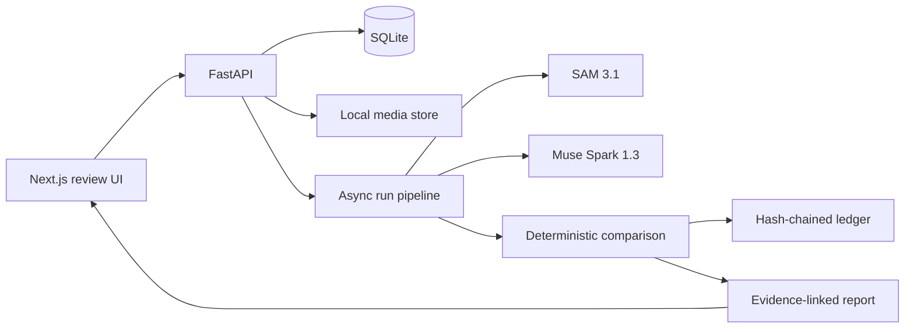

# MotionLedger

**AI that audits how work actually happens.**

MotionLedger compares a manufacturing work instruction with a video of the process. It turns model observations into typed, evidence-linked possible discrepancies, then lets a reviewer correct the interpretation and rerun a deterministic comparison.

> **Trust rule:** models perceive and interpret; deterministic code decides. A machine result is never a final quality verdict. `UNVERIFIABLE` means the decisive moment was not visible and must not be treated as an omission.

This repository implements the flange-gasket MVP in `IMPLEMENTATION_PLAN.md`.

## What is implemented

### Working end-to-end slice

- FastAPI backend with SQLite persistence for procedures, videos, audits, run versions, overrides, model-call usage and an append-only ledger.
- Versioned procedure schema, reference validation and dependency-cycle validation. The included flange procedure expands the four bolt insertion and tightening steps into zone-specific instances.
- MP4/MOV ingest, ffprobe validation, 15 fps H.264 proxy normalization and frame-addressable JPEG evidence endpoints.
- Meta Model API client using the official OpenAI-compatible Responses API base URL. The API key stays on the backend.
- Muse Spark work-instruction compiler and full-video reconnaissance/structured step-verification calls.
- SAM 3.1 video segmentation calls per procedure object, parsed into per-frame mask RLE and compressed mask artifacts with boxes, confidence, area, centroid and principal-axis angle. Raw streaming event logs are retained per run and object.
- Mask-derived physical signal measurements for hand/object contact, object carrying and tool rotation while it overlaps the procedure subject. These are attached to the run report with timestamps and numeric features.
- Deterministic comparison engine: omission, incomplete, unverifiable, order violation, pattern violation, repeated action, extra action and postcondition checks; prerequisite blocking prevents cascading accusations.
- Reviewer actions: confirm/dismiss findings, add an observation, retime/confirm step observations, and recompare without another model call.
- Content-addressed artifact caching for Muse Spark reconnaissance/verdicts and SAM raw/decoded outputs. `MOTIONLEDGER_OFFLINE=1` replays a complete cached run and stops on a cache miss without network access.
- New run versions with parent pointers, version diff, JSON/CSV/printable HTML report exports and SHA-256 hash-chained audit ledger verification.
- Review dashboard, upload flow, procedure compiler/editor, video player, timeline, evidence cards, findings review, cost/status display and ledger panel.
- Synthetic sample clip/report for exploring the review experience without a Meta API key. It is explicitly marked **SIMULATION ONLY** and is not presented as inference from real footage.
- Unit tests for engine behavior, mask decoding/artifact persistence, physical signal extraction, geometry helpers, hysteresis and ledger integrity.

### Deliberate integration boundary in this first build

The live pipeline now connects SAM 3.1's streamed video segmentation to the official parser, persists decoded masks and per-frame geometry, and derives contact, carrying and tool-rotation primitives. Muse Spark's structured video verdicts remain the current step-observation layer used by the deterministic comparison engine.

The following planned capabilities are not yet complete end-to-end: automatic zone grounding and projection; zone-specific placement/insertion and torque-pattern primitives; tracklet stitching through occlusion/re-entry; calibrated signal/model fusion; set-of-mark evidence packets and model-verified keyframe crops; optional Muse Voice transcription and face redaction; merging a click-to-segment result into a new track version; and selective re-verification using `previous_response_id`. The local content cache covers recon, SAM segmentation and Muse Spark step-verification artifacts. The review player requests frame-indexed transparent mask overlays from the backend and can toggle them on/off; it also shows measured contact/carry/rotation signals. These limitations are surfaced in the report rather than hidden. Treat live findings as review candidates, not validated industrial inspection.

The synthetic demo is only for demonstrating the UI and reviewer workflow. A real production audit requires a Meta Model API key and appropriate consent/authorization for the footage.

## Architecture



## Requirements

- Python 3.12 or newer
- Node.js 20.17+ or 22.9+
- ffmpeg 5.1+ and ffprobe on `PATH`
- A Meta Model API key for live model-backed audits

Meta Model API reference: <https://dev.meta.ai/docs/api-reference>  
SAM parser: <https://pypi.org/project/meta-sam-parser/>

## Run locally (Windows PowerShell)

From the repository root, the helper scripts install dependencies and open both development servers:

```powershell
.\setup.ps1
# Edit the generated .env and set MODEL_API_KEY to your Meta Model API key for live analysis.
.\start.ps1
```

Or run the services manually:

```powershell
Copy-Item .env.example .env
# Edit .env and set MODEL_API_KEY to your Meta Model API key.

cd apps/api
py -3.12 -m venv .venv
.\.venv\Scripts\Activate.ps1
pip install -e ".[dev]"
uvicorn motionledger.main:app --reload --port 8000
```

In a second terminal:

```powershell
cd apps/web
npm install
npm run dev
```

Open <http://localhost:3000>. API docs are at <http://localhost:8000/docs>.

### macOS / Linux

```bash
cp .env.example .env
# Edit .env and set MODEL_API_KEY.
cd apps/api
python3.12 -m venv .venv
source .venv/bin/activate
pip install -e '.[dev]'
uvicorn motionledger.main:app --reload --port 8000
```

Second terminal:

```bash
cd apps/web
npm install
npm run dev
```

The `.env.example` data paths assume the API is launched from `apps/api`, as in the commands above. The web app never receives the Meta key. The UI uses system fonts and does not fetch font files from a third-party CDN.

## Try it without a key

1. Start the backend and frontend.
2. Open the dashboard at <http://localhost:3000>.
3. Click **Explore sample audit**.
4. Inspect the synthetic video, illustrative incomplete-step and unverifiable findings, review controls, version history and ledger.

The sample is generated locally at first use; no API calls are made. It is labelled SIMULATION ONLY in the report and player.

## Run a real audit

1. Obtain a key from the Meta Model API dashboard and place it in `.env` as `MODEL_API_KEY=...`.
2. Restart the backend so it loads the key.
3. Record a top-down view with the whole flange and tool tray visible, good diffuse light, no motion blur, and the fixture filling most of the frame.
4. Create an audit, upload an MP4/MOV, select the flange procedure and confirm that you have authorization to process the recording.
5. Review the resulting candidate findings. Confirm or dismiss only after checking the source footage.

Current live pipeline uses `muse-spark-1.3` Standard mode and `sam-3.1`. SAM event logs are stored under `data/logs/<run_id>/`; decoded mask/geometry archives and summaries are stored under `data/tracks/<run_id>/`; reusable immutable artifacts are stored under `data/cache/`. Set `MOTIONLEDGER_OFFLINE=1` only after a successful online run has populated all the needed cache entries.

## Configuration

| Variable | Default | Purpose |
|---|---:|---|
| `MODEL_API_KEY` | empty | Meta Model API bearer key |
| `META_BASE_URL` | `https://api.meta.ai/v1` | Model API base URL |
| `SPARK_MODEL` | `muse-spark-1.3` | Muse Spark model |
| `SAM_MODEL` | `sam-3.1` | SAM model |
| `ANALYSIS_FPS` | `15` | Proxy frame rate and report clock |
| `MAX_LONG_EDGE` | `1280` | Maximum proxy dimension |
| `MAX_VIDEO_SECONDS` | `300` | Upload duration limit |
| `MAX_UPLOAD_BYTES` | `1073741824` | Maximum upload size |
| `SAM_CONCURRENCY` | `4` | Concurrent SAM concept jobs |
| `SPARK_CONCURRENCY` | `6` | Reserved Spark concurrency setting |
| `FILES_TTL_SECONDS` | `604800` | Meta Files API expiry (7 days) |
| `MOTIONLEDGER_OFFLINE` | `0` | Reuse cached model artifacts only; fail on cache misses without network calls |
| `DATA_DIR` | `../../data` | Local media and database directory |
| `DATABASE_URL` | `sqlite:///../../data/motionledger.db` | SQLite database path |

## API routes

| Method | Path | Description |
|---|---|---|
| GET | `/health` | Backend health and Meta-key availability |
| GET/POST | `/api/procedures` | List and create procedures |
| GET/PUT | `/api/procedures/{id}` | Get and save a new procedure version |
| POST | `/api/procedures/compile` | Compile work instruction with Muse Spark |
| POST | `/api/videos` | Upload and normalize a video |
| GET | `/api/videos/{id}` | Video metadata |
| GET | `/api/videos/{id}/proxy.mp4` | Normalized video |
| GET | `/api/videos/{id}/frames/{n}.jpg` | Evidence frame |
| POST | `/api/audits` | Create audit and start live pipeline |
| POST | `/api/demo/seed` | Create synthetic sample audit |
| GET | `/api/audits` | Dashboard list |
| GET | `/api/audits/{id}` | Audit details and run versions |
| GET | `/api/runs/{id}` | Run status |
| GET | `/api/runs/{id}/events` | SSE progress stream |
| GET | `/api/runs/{id}/report` | Structured report JSON |
| GET | `/api/runs/{id}/report.html` | Printable report |
| GET | `/api/runs/{id}/tracks` | Model call summaries, usage and per-object track summaries |
| GET | `/api/runs/{id}/overlays/{frame}.png` | Transparent SAM mask overlay for a proxy-video frame |
| GET | `/api/runs/{id}/sam/{object}.jsonl` | Raw SAM events for one concept |
| POST | `/api/audits/{id}/overrides` | Reviewer correction |
| POST | `/api/audits/{id}/runs` | Recompare or re-verify |
| POST | `/api/audits/{id}/segment` | Point-prompt SAM re-segmentation |
| GET | `/api/runs/{a}/diff/{b}` | Version diff |
| GET | `/api/audits/{id}/ledger` | Ledger entries and integrity check |
| GET | `/api/audits/{id}/export.json` | JSON export |
| GET | `/api/audits/{id}/export.csv` | CSV export |

## Tests

```bash
cd apps/api
pip install -e '.[dev]'
pytest -q
```

The current test suite covers:
- Procedure step expansion and deterministic report behavior.
- Missing, incomplete, occluded/unverifiable, order and pattern cases.
- Postcondition evaluation and stable finding identifiers.
- Binary-mask geometry, zone occupancy, principal-axis rotation, mask decoding/persistence, mask-derived contact/carry signals and hysteresis.
- Ledger creation and tamper detection.

## Evaluation

The planned evaluation set is twelve labelled 30–90 second assembly clips: correct run, skipped tightening, one skipped bolt, prerequisite order violation, wrong cross pattern, missing bolt, too-short wrench touch, occlusion, repeated gasket placement, extra hammer taps, alternate lighting/camera angle, and a faster second operator.

Metrics: per-type precision/recall/F1 at temporal IoU ≥0.3; false-accusation rate (target <5%); false unverifiable rate on clean clips (target <10%); median timestamp error (target <0.5s); and reviewer time saved. No evaluation result is claimed until clips are recorded, labelled and measured.

## Privacy and responsible use

- Audit the **process**, not individual worker performance. Do not use reports for worker ranking, productivity scoring, or disciplinary decisions.
- Obtain recording consent and follow site policy before uploading footage.
- Real footage is sent to Meta Model API when live analysis is run. The server stores the API key and the normalized clip locally; never put the key in frontend variables.
- Standard-mode Muse Spark is used for real footage. The API Files upload is configured with a seven-day expiry.
- Reports are suggestions requiring a qualified reviewer. `UNVERIFIABLE` is never converted into an omission solely because a model could not see the action.
- Account for camera angle, occlusion, lighting, look-alike parts, model uncertainty and the limitations listed above before any operational use.

## Build status

This is an initial runnable MVP implementation, not the fully evaluated industrial product. The deterministic engine, reviewer workflow, audit ledger, SAM stream decoding and baseline physical signal measurements are implemented. The remaining integration work is listed explicitly above and in the build plan.
